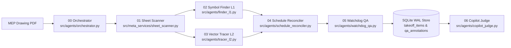

# BlueTraceAI

**MEP drawing review, grounded in the sheet.** BlueTraceAI is a takeoff application for mechanical, electrical, and plumbing (MEP) estimators that brings Meta model-assisted drawing interpretation together with deterministic local PDF geometry and engineer review.

<p align="center">
  <a href="https://weslyjohn1307.github.io/BlueTrace/">Open the interactive showcase</a> ·
  <a href="#run-locally">Run locally</a> ·
  <a href="#how-it-works">How it works</a> ·
  <a href="#multi-agent-workflow">Agent workflow</a> ·
  <a href="#evaluation-and-verification">Evaluation</a> ·
  <a href="#project-status">Project status</a>
</p>


<p align="center"><sub>The focus frame and stage sequence are editorial motion overlays on a real workspace capture, not live interface behavior. <a href="docs/assets/readme-motion-poster.png">Static poster</a></sub></p>

BlueTraceAI continues an MEP takeoff project that predates the Meta Global AI Developer Hackathon. This entry is for the **Indie Developer** track and is framed around **Push the Frontier**. The hackathon work extends the project's hybrid vector and raster foundation with a seven-agent drawing review workflow, batch sheet intake, grounded copilot citations, and standalone desktop packaging.

## How it works

Commercial MEP drawing sets combine fine text callouts with dense vector linework and frequently mix scales across plan views and enlarged details (for example, a floor plan at $1/8" = 1'-0"$ alongside a mechanical room detail at $1/4" = 1'-0"$ or $1/2" = 1'-0"$). Passing an entire large-format sheet into a general vision model downsamples small annotations and produces ungrounded length estimates.

BlueTraceAI separates drawing interpretation from physical measurement so that quantities stay traceable to the sheet:

1. **Open and index a drawing set.** Batch intake (`POST /api/intake/batch`) and sheet reconnaissance (`src/core_vector/pipeline.py`, `src/meta_services/sheet_scanner.py`) parse native PDF text, title block metadata, discipline classification, and candidate scale ratios while streaming progress over Server-Sent Events (SSE).
2. **Read drawing context at the point of need.** Instead of downsampling full sheets, the workspace sends localized $300 \times 300\text{ px}$ crops at 150 DPI, legend regions, and schedule tables to Meta models (`src/meta_services/client.py`, `src/meta_services/legend_scanner.py`) to read text, dimensions, and symbol exemplars.
3. **Ground physical quantities in local geometry.** Local Python modules extract vector path segments directly from the PDF graphics state via PyMuPDF (`src/core_vector/extractor.py`), pair parallel duct walls and compute medial-axis centerlines via Shapely (`src/core_vector/centerline.py`), and splice continuous routes and T-junctions via NetworkX (`src/core_vector/continuity.py`). PDF point lengths ($72\text{ pt/in}$, $864\text{ pt/ft}$) convert to linear feet only when the sheet scale is verified:
   $$L_{\text{ft}} = \frac{L_{\text{pt}} \times S_{\text{ratio}}}{864}$$
4. **Fail closed on ambiguous scale.** When a sheet has no detected scale or conflicting scale signals, the validator (`src/core_vector/scale_validator.py`) sets `scale_ratio = 0.0` and `review_required = True`. Uncalibrated items remain visible for review and return `HTTP 409 Conflict` if acceptance is attempted before two-point calibration (`PATCH /api/sheets/{sheet_id}/calibration`).
5. **Review, reconcile, and export the ledger.** Every proposed item enters the local SQLite WAL store (`src/store/takeoff_store.py`) as `SUGGESTED`. Estimators inspect items on the canvas, reconcile plan detections against schedule rows, record `ACCEPT`, `CORRECT`, or `REJECT` decisions with structured override reason codes in `review_events`, and export CSV or JSON summaries.

Meta models interpret visual and language content. They do not calculate physical lengths. Scale-dependent measurement belongs to local vector geometry and a validated scale ratio; the estimator decides whether a proposed item is accepted.

## What is in the application

- **150 DPI drawing workspace** (`frontend/src/workspace/TakeoffWorkspace.tsx`) — open PDFs, inspect sheet discipline and scale state, navigate multi-sheet sets through a virtualized filmstrip (capped at a 50-page in-memory thumbnail budget), pan/zoom/rotate via 2D affine transforms, and calibrate unverified sheets with a two-point dimension tool.
- **Point-of-need crop reading** (`POST /api/crop-ocr`) — request a 150 DPI crop around a cursor location and review the extracted label or duct dimension (`width`, `height`, `shape`), backed by SHA-256 response caching.
- **Deterministic vector centerline takeoff** (`GET /api/sheets/{sheet_id}/linework`) — trace double-line ductwork corridors, split tee junctions, and roll up quantities across CSI MasterFormat Divisions 22 (Plumbing), 23 (HVAC), and 26 (Electrical).
- **Schedule reconciliation and watchdog QA** (`POST /api/agents/reconcile`, `POST /api/agents/watchdog`) — compare parsed schedule tags against plan detections, surface candidate ghost pins or count mismatches without silently overwriting ledger quantities, and persist rule-based QA annotations (`qa_annotations`).
- **Evidence-grounded copilot** (`POST /api/copilot`, `POST /api/copilot/stream`) — ask questions against the active drawing and SQLite takeoff store; answers return clickable evidence citations (`ev:<sheet>:<type>:<x>:<y>`) that focus the canvas on the referenced item.
- **Standalone launcher and desktop sidecar packaging** (`scripts/start_standalone.py`, `src-tauri/`, `bluetrace-core.spec`) — run the compiled frontend and FastAPI backend on a single local port, or package the backend as a PyInstaller `--onedir` sidecar supervised by a Tauri v2 Rust host using a Windows Job Object (`JOB_OBJECT_LIMIT_KILL_ON_JOB_CLOSE`).


The crop reading above is marked for review because the sheet scale is unverified. It is not presented as a validated physical measurement.

<table width="100%">
  <tr>
    <td width="50%" valign="top">
      
      <p><strong>Point-of-need crop reading.</strong> A localized 150 DPI crop around the cursor extracts text callouts and duct dimensions while keeping uncalibrated readings flagged for review.</p>
    </td>
    <td width="50%" valign="top">
      
      <p><strong>Grounded takeoff copilot.</strong> Queries run against the local SQLite ledger and return coordinate citations that pan and zoom the canvas to the referenced drawing location.</p>
    </td>
  </tr>
</table>

## Multi-agent workflow

The hackathon extension coordinates drawing reconnaissance, symbol finding, vector tracing, schedule reconciliation, quality checks, and copilot verification across seven product-plane agent modules (`src/agents/`):



| Agent | Module | Responsibility |
|---|---|---|
| **00 Orchestrator** | `src/agents/orchestrator.py` | Routes sheets by type (`PLAN`, `LEGEND`, `SCHEDULE`), assigns deterministic `ev:<sheet>:<type>:<x>:<y>` evidence IDs, and logs per-stage execution traces (`POST /api/agents/orchestrate`). |
| **01 Sheet Scanner** | `src/meta_services/sheet_scanner.py` | Extracts sheet numbers, disciplines, and scale candidates, and enforces the fail-closed scale gate (`src/core_vector/pipeline.py`). |
| **02 Symbol Finder (L1)** | `src/agents/finder_l1.py` | Parses legend exemplars first (`src/meta_services/legend_scanner.py`), tiles plan sheets at 150 DPI ($1024\text{ px}$ tiles with $128\text{ px}$ overlap), and deduplicates symbol boxes via class-aware NMS (`src/meta_services/symbol_swarm.py`). |
| **03 Vector Tracer (L2)** | `src/agents/tracer_l2.py` | Extracts native PDF vector segments, pairs parallel walls into centerline corridors, splits T-junctions, and caches geometry by file SHA-256 (`src/core_vector/`). |
| **04 Schedule Reconciler** | `src/agents/schedule_reconciler.py` | Reconciles schedule equipment tags against plan symbol counts (`src/store/reconciler.py`) and emits candidate ghost pins or mismatch flags without silently altering quantities. |
| **05 Watchdog QA** | `src/agents/watchdog_qa.py` | Runs deterministic rule checks for uncalibrated scales, schedule-vs-plan mismatches, and unreviewed items, persisting durable `qa_annotations`. |
| **06 Copilot Judge** | `src/agents/copilot_judge.py` | Executes read-only SQLite tool queries (`src/agents/tools.py`), verifies that every `ev:` citation resolves to a stored entity, and discloses unverified sheet scales. |

## Meta models

BlueTraceAI uses Meta models (`https://api.meta.ai/v1`) for visual interpretation and grounded reasoning over MEP drawings. Local Python code owns PDF vector geometry, scale math, and transactional storage.

| Model | Role in the project | Live API behavior (`MODEL_API_KEY` set) | Offline / unconfigured behavior |
|---|---|---|---|
| **Muse Spark 1.3** (`muse-spark-1.3`) | Vision and OCR for 150 DPI cursor crops, title blocks, legend exemplars, and schedule tables (`src/meta_services/client.py`). | Sends cropped PNG/WebP regions for structured tag, dimension, and table extraction. | Crop OCR and schedule parsing return labeled offline stubs (`mock = True`, `confidence = 0.0`, `review_required = True`); legend scanning abstains with `NO_LEGEND_FOUND`. |
| **Muse Wonder 1.0** (`muse-wonder-1.0`) | Copilot reasoning and citation synthesis over SQLite takeoff evidence (`src/meta_services/copilot.py`, `src/agents/copilot_judge.py`). | Synthesizes natural-language answers from read-only SQLite tool results with verified `ev:` citations. | Returns deterministic local SQLite evidence summaries (`offline = True`) with verified coordinate citations. |
| **SAM 3.1** (`sam-3.1`) | Region and symbol boundary segmentation via `/v1/responses` (`src/meta_services/client.py`). | Returns segmentation polygon masks for selected drawing regions. | Abstains with an empty polygon list (`polygons = []`, `confidence = 0.0`, `review_required = True`) rather than fabricating geometry. |

Live model calls require `MODEL_API_KEY` and network access. Without a key, the application runs locally; model-dependent endpoints return clearly labeled offline responses or abstain fail-closed. Offline output is never presented as live Meta inference.

## Run locally

The standalone launcher serves the compiled React 19 frontend and FastAPI application on one local port. It builds `frontend/dist` automatically if the production bundle is missing.

**Prerequisites:** Windows (tested in CI on `windows-latest`), Python 3.10–3.13, Node.js 24, and npm.

```powershell
git clone https://github.com/weslyjohn1307/BlueTrace.git
cd BlueTrace
py -3 -m venv .venv
.\.venv\Scripts\python.exe -m pip install -e ".[dev]"
npm --prefix frontend ci
.\.venv\Scripts\python.exe scripts/start_standalone.py
```

Open the local URL printed by the launcher (port `8000` by default; the interactive OpenAPI reference is served at `/docs` on the same address, and `GET /api/health` returns `{"status": "ok"}`).

To enable live Meta requests, copy `.env.example` to `.env` and set `MODEL_API_KEY` there, or supply a session-scoped key through the in-app **API Key (BYOK)** modal (`POST /api/auth/byok`). Keep credentials out of source files and `VITE_*` frontend build variables.

<details>
<summary><strong>Alternative setup: dual-terminal development & desktop sidecar packaging</strong></summary>

**Dual-terminal development servers:**

```powershell
# Terminal 1: FastAPI backend with auto-reload on port 8000
.\.venv\Scripts\python.exe -m uvicorn src.api.main:app --port 8000 --reload

# Terminal 2: Vite development server
npm --prefix frontend run dev
```

**Desktop sidecar packaging validation (PyInstaller + Tauri v2):**

```powershell
# Verify PyInstaller sidecar spec and required hidden imports
.\.venv\Scripts\python.exe scripts/build_sidecar.py --dry-run

# Verify Tauri v2 configuration, NSIS installer hooks, and Ed25519 updater keys
.\.venv\Scripts\python.exe scripts/validate_packaging_manifest.py
```

</details>

## Evaluation and verification

Repository fixtures in `fixtures/mechanical/` provide reproducible local verification of vector extraction, coordinate tiling, schedule reconciliation, watchdog rules, and fail-closed offline behavior (`docs/EVAL_REPORT.md`):

| Verification target | Fixture / input | Measured result | Command |
|---|---|---|---|
| **Vector centerline extraction** | `fixtures/mechanical/avexis_page_22.pdf` (Page 22 mechanical plan) | **329** extracted centerline runs vs. **329** ground-truth runs (`0.00%` count error; `636.62 ft` calibrated at $1/8" = 1'-0"$, `0.00 ft` when uncalibrated) | `.\.venv\Scripts\python.exe scripts/generate_eval_report.py` |
| **Geometry SHA-256 cache** | `fixtures/mechanical/avexis_page_22.pdf` | Warm cache lookup in `< 2.0 ms` (`1.35 ms` recorded vs. `23.47 s` cold 6-stage topological extraction) | `.\.venv\Scripts\python.exe scripts/generate_eval_report.py` |
| **Tiling coordinate round-trip** | `pfmcc_page_118_gt.json` (168 boxes) & `avexis_page_22_gt.json` (21 boxes) | `0.000000 pt` max untile drift (`<= 0.50 pt` gate); `0` fabricated items in offline mode | `.\.venv\Scripts\python.exe scripts/generate_eval_report.py` |
| **Schedule & watchdog gates** | Seeded schedule-vs-plan fixture | `1.00` mismatch recall (`1` matched, `1` ghost pin, `2` mismatch flags); durable `qa_annotations` persisted | `.\.venv\Scripts\python.exe scripts/generate_eval_report.py` |

Run the test, lint, type-check, and sanitizer suites from a clean environment:

```powershell
.\.venv\Scripts\python.exe -m pytest tests/ -q
.\.venv\Scripts\python.exe -m ruff check src/ tests/ scripts/
.\.venv\Scripts\python.exe -m mypy
.\.venv\Scripts\python.exe scripts/sanitize_import.py --audit
npm --prefix frontend run test -- --run
npm --prefix frontend run lint
npm --prefix frontend run build
```

## Project status

**Active prototype.** The 150 DPI drawing workspace, deterministic vector centerline engine, fail-closed scale governance, SQLite WAL takeoff store, seven-agent orchestration pipeline, standalone single-port server, and Tauri v2 + PyInstaller sidecar packaging configuration are implemented in this repository and tested in CI across Python 3.10–3.13 and Node.js 24.

**Known limitations and boundaries:**

- **Not an autonomous bidding system.** Estimators must verify drawing context, scale calibration, and quantities before relying on a takeoff for commercial bidding.
- **Native vector PDF requirement for centerline geometry.** Automatic wall pairing and centerline length extraction require PDF drawings exported with vector primitives (such as AutoCAD, Revit, or MagiCAD exports). Scanned raster-only blueprints contain no vector paths and trigger `review_required = True` with `scale_ratio = 0.0` for manual calibration and review.
- **Live Meta API credentials required for cloud perception.** Without `MODEL_API_KEY`, the deterministic vector pipeline, scale calibration, ledger review state machine, watchdog rules, and CSV/JSON exports operate offline, while model-backed OCR, legend vision, segmentation, and copilot synthesis return labeled offline responses or abstain fail-closed.
- **Single-node local persistence.** Takeoff data is stored locally in an SQLite WAL database (`data/bluetrace.db`). Multi-user cloud synchronization is not implemented.

## Data and credentials

The application stores project metadata, sheet records, takeoff items, review events, and QA annotations in a local SQLite database (`data/bluetrace.db`). Uploaded PDFs and cached thumbnails stay on the local disk under `data/` (gitignored).

When a live Meta feature is invoked with `MODEL_API_KEY` configured, the submitted drawing crop, legend region, schedule image, or copilot prompt is sent to the Meta Model API (`https://api.meta.ai/v1`) for processing. Only use project drawings with the permissions required by your organization. Engineer correction crops recorded via `POST /api/feedback/events` are stored locally with `training_eligible = 0` by default. Supply API keys only to the backend via `.env` or the session-scoped BYOK endpoint; never place keys in a `VITE_*` variable or commit them to the repository.

## Documentation

- [Product vision](docs/PRODUCT-VISION.md)
- [Implemented UI flows](docs/specs/UI-UX-FLOWS.md)
- [Fixture evaluation report](docs/EVAL_REPORT.md)
- [REST & SSE API reference](docs/API_REFERENCE.md)
- [Operator runbook & data retention guide](docs/RUNBOOK.md)
- [Hybrid MEP architecture decision (ADR-001)](docs/adr/ADR-001-hybrid-mep-architecture.md)
- [Offline engine reuse & point-of-need UX (ADR-002)](docs/adr/ADR-002-reusing-offline-engine-and-point-of-need-ux.md)
- [VLM detection & legend-first architecture (ADR-003)](docs/adr/ADR-003-vlm-detection-replaces-yolo.md)
- [Standalone single-port launcher](scripts/start_standalone.py)
- [Meta API configuration example](.env.example)

## License

BlueTraceAI is available under the [Apache License 2.0](LICENSE).
