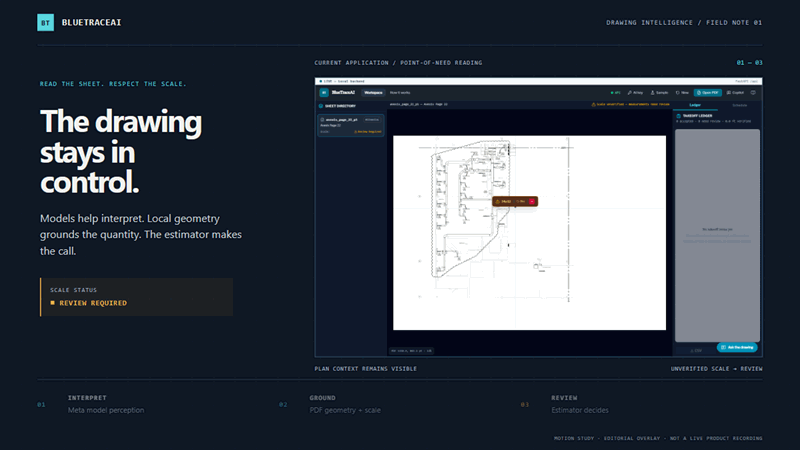

# BlueTraceAI

**MEP drawing review, grounded in the sheet.** BlueTraceAI is an in-progress takeoff application for MEP estimators that brings model-assisted drawing interpretation together with local PDF geometry and engineer review.

<p align="center">
  <a href="#run-locally">Run locally</a> ·
  <a href="#how-it-works">How it works</a> ·
  <a href="#project-status">Project status</a>
</p>



<p align="center"><sub>The focus frame and stage sequence are editorial motion overlays, not live interface behavior. <a href="docs/assets/readme-motion-poster.png">Static poster</a> · <a href="docs/assets/readme-motion-source.html">Editable HTML source</a></sub></p>

BlueTraceAI continues an MEP takeoff project that predates the Meta Global AI Developer Hackathon. This entry is for the **Indie Developer** track and is framed around **Push the Frontier**. The current hackathon work extends the project's hybrid vector and raster foundation toward a multi-agent workflow. It is a prototype in active development; the full agent pipeline is not yet complete.

## The workflow

The goal is to make drawing review more traceable while keeping measurement and approval grounded in engineering evidence.

1. **Open a sheet.** Load a PDF and inspect its plan in the drawing workspace.
2. **Read the drawing.** Meta model integrations support OCR and visual interpretation of sheet details, schedules, and legends.
3. **Ground the quantity.** Local PDF geometry and scale checks provide the basis for measurement. Unverified scale stays visible as review work.
4. **Review the evidence.** Inspect suggested items on the drawing, decide what belongs in the takeoff, and export the ledger.

Meta models help interpret visual and language content. They do not determine physical lengths. Scale-dependent measurement belongs to local geometry and a validated scale; the estimator decides whether a proposed item is accepted.

## What is in the current prototype

- **PDF workspace** — open a drawing, view a sheet, and inspect its discipline and scale status.
- **Point-of-need reading** — request a crop around a drawing detail and review the returned text or dimension.
- **Takeoff review** — inspect suggested and accepted items in a ledger, with review actions and CSV or JSON export paths.
- **Schedule and copilot flows** — parse schedule content and ask questions about the current drawing or takeoff. Responses may use a clearly labeled offline path when live model access is unavailable.


The crop reading is marked for review because the sheet scale is unverified. It is not presented as a validated physical measurement.

## Meta models

BlueTraceAI uses Meta models for interpretation and reasoning around MEP drawings. Local code handles PDF geometry, scale math, and takeoff storage.

| Model | Role in the project | Current scope |
|---|---|---|
| **Muse Spark 1.3** | Vision and OCR for sheet details, schedule content, and legend or symbol context. | Integrated in drawing-reading paths; live inference requires Meta API credentials. |
| **Muse Wonder 1.0** | Copilot reasoning over takeoff evidence, with a tool-calling path. | Agent implementation is in progress; the complete workflow is not yet accepted end to end. |
| **SAM 3.1** | Image segmentation for selected visual regions. | Experimental integration; not presented here as a finished symbol-detection workflow. |

Live model calls require `MODEL_API_KEY` and network access. Without a key, the application can run locally; model-dependent features may return a labeled offline response or be unavailable. Do not treat offline output as live Meta inference.

## Run locally

The standalone launcher serves the frontend and FastAPI application on one local port. It builds the frontend if the production bundle is missing.

**Prerequisites:** Windows, Python 3.10–3.13, Node.js 24, and npm.

```powershell
git clone https://github.com/weslyjohn1307/BlueTrace.git
cd BlueTrace
py -3 -m venv .venv
.\.venv\Scripts\python.exe -m pip install -e .
npm --prefix frontend ci
.\.venv\Scripts\python.exe scripts/start_standalone.py
```

Open the local URL printed by the launcher. The standalone server uses port 8000 by default; the API reference is available at `/docs` on the same address.

The app can be launched without a Meta key. To enable live Meta requests, copy `.env.example` to `.env` and set `MODEL_API_KEY` there, or enter a key through the in-app key flow. Keep credentials out of source files and frontend build variables.

## Project status

**Active prototype.** The drawing workspace and core takeoff flows are the foundation; the hackathon extension is the agent-based coordination layer. Agent modules for sheet reconnaissance, finding, tracing, and copilot reasoning are being developed, but the full set of seven roles is not yet connected and verified as one end-to-end workflow.

This project is not an autonomous bidding system. Estimators must verify drawing context, scale, and quantities before relying on a takeoff. Batch processing, a packaged installer, and a complete multi-agent workflow remain in development.

## Data and credentials

The application stores takeoff data in a local SQLite database. When a Meta feature is invoked, its submitted drawing content or crop is sent to the Meta Model API for processing. Only use project drawings with the permissions required by your organization. The API key is supplied to the backend; never place it in a `VITE_*` variable or commit it to the repository.

## Documentation

- [Product vision](docs/PRODUCT-VISION.md)
- [Implemented UI flows](docs/specs/UI-UX-FLOWS.md)
- [Hybrid architecture decision](docs/adr/ADR-001-hybrid-mep-architecture.md)
- [Standalone launcher](scripts/start_standalone.py)
- [Meta API configuration example](.env.example)

## License

No public license is declared in this repository. Reuse and redistribution rights have not been granted here.
