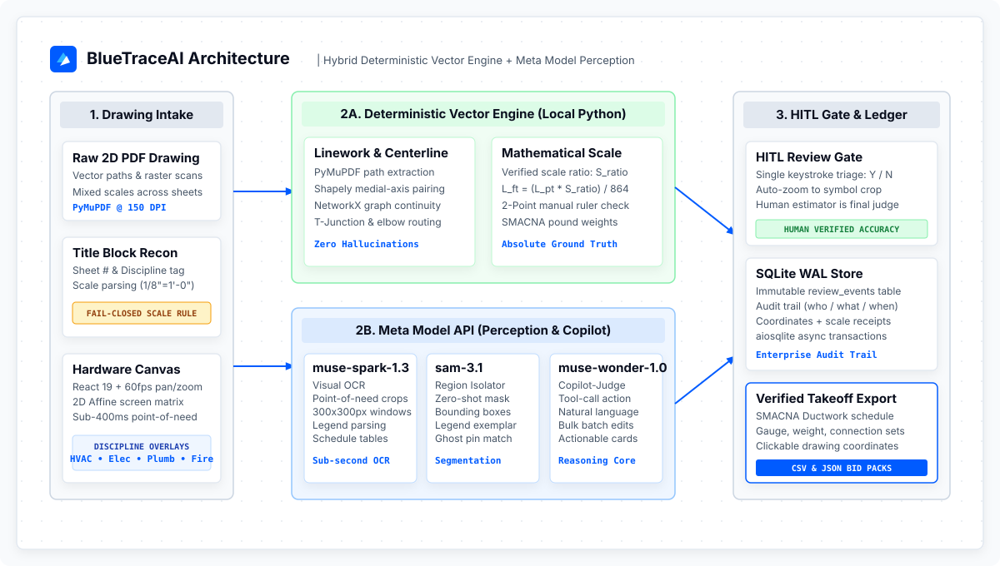
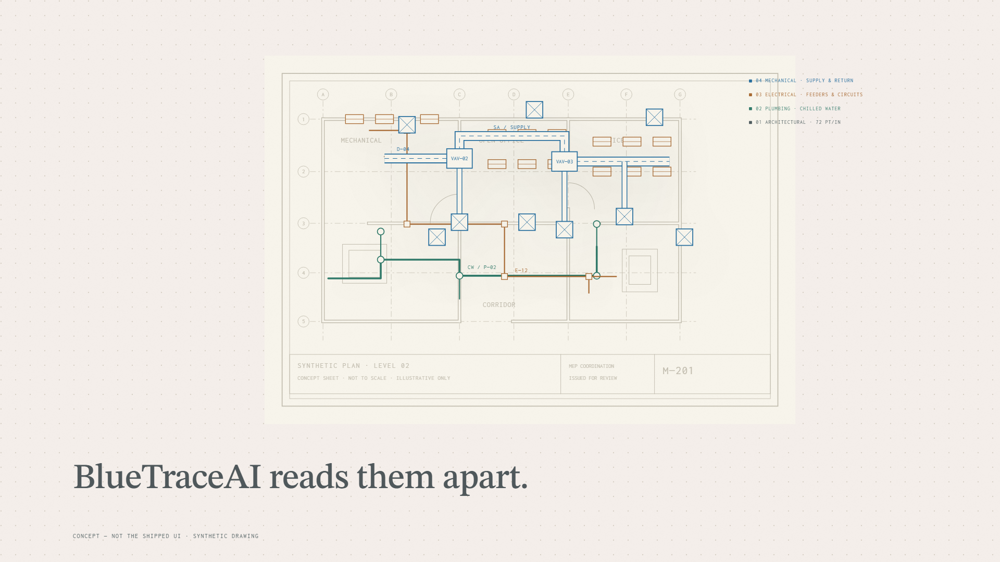
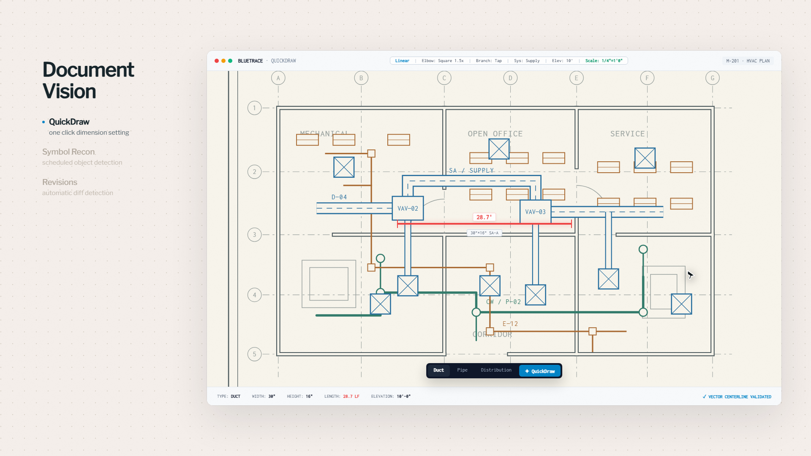
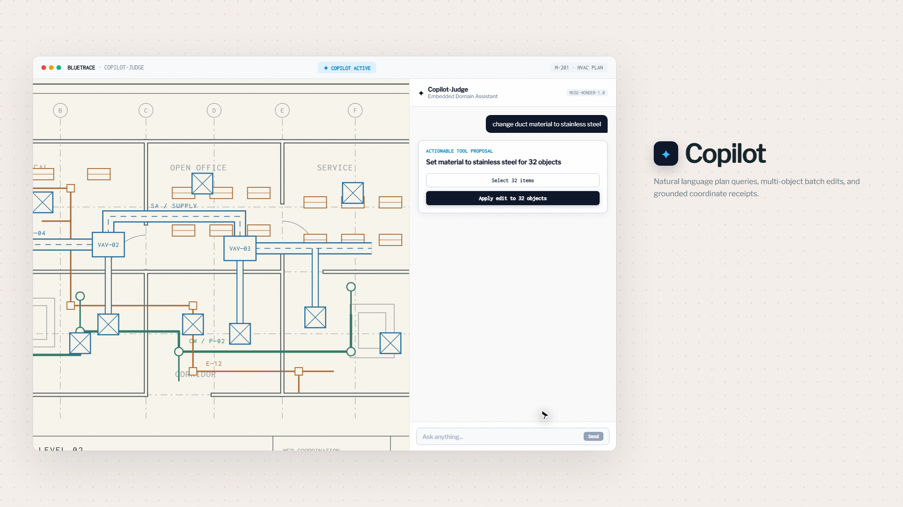
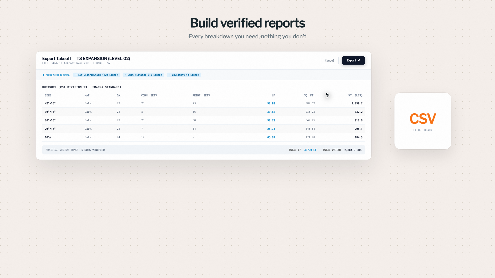
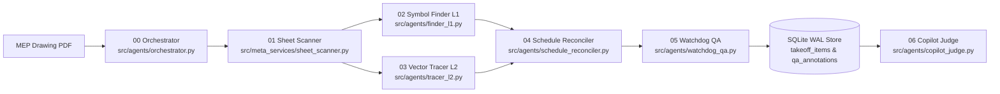

<p align="center">
  <a href="https://weslyjohn1307.github.io/BlueTrace/">
    <picture>
      <source media="(prefers-color-scheme: dark)" srcset="docs/assets/brand/bluetrace-logo-dark.svg">
      <source media="(prefers-color-scheme: light)" srcset="docs/assets/brand/bluetrace-logo-light.svg">
      
    </picture>
  </a>
</p>

<p align="center">
  <strong>MEP drawing review, grounded in the sheet.</strong><br>
  Deterministic Vector Linework &bull; Meta Foundation Models &bull; Human-in-the-Loop Takeoff Store
</p>

<p align="center">
  <a href="https://x.com/Weslyjohn1307/status/2118101699739140558"></a>
  <a href="https://github.com/weslyjohn1307/BlueTrace/blob/master/docs/assets/BlueTraceAI_Demo.mp4"></a>
  <a href="https://weslyjohn1307.github.io/BlueTrace/"></a>
  <a href="docs/SUBMISSION.md"></a>
  <a href="#run-locally"></a>
  <a href="LICENSE"></a>
</p>

<p align="center">
  <a href="https://x.com/Weslyjohn1307/status/2118101699739140558"><strong>Watch on X (2 min)</strong></a> &bull;
  <a href="https://github.com/weslyjohn1307/BlueTrace/blob/master/docs/assets/BlueTraceAI_Demo.mp4"><strong>Watch on GitHub (Web Player)</strong></a> &bull;
  <a href="https://weslyjohn1307.github.io/BlueTrace/"><strong>Interactive Concept Walkthrough</strong></a> &bull;
  <a href="docs/SUBMISSION.md"><strong>Submission Story</strong></a> &bull;
  <a href="#run-locally"><strong>Run Locally</strong></a> &bull;
  <a href="#how-it-works"><strong>Architecture</strong></a> &bull;
  <a href="#evaluation-and-verification"><strong>Evaluation</strong></a>
</p>

---

<p align="center">
  <a href="https://x.com/Weslyjohn1307/status/2118101699739140558">
    
  </a>
</p>
<p align="center">
  ▶️ <strong><a href="https://x.com/Weslyjohn1307/status/2118101699739140558">Watch Demo Film on X</a></strong> &bull; <strong><a href="https://github.com/weslyjohn1307/BlueTrace/blob/master/docs/assets/BlueTraceAI_Demo.mp4">Watch on GitHub (Web Player)</a></strong> (2:00 min &bull; 1080p &bull; Voiceover Narration)
</p>

BlueTraceAI is a desktop takeoff tool built for commercial mechanical, electrical, and plumbing (MEP) contractors. I submitted it to the **Meta Global AI Developer Hackathon** under the **Indie Developer Track: Push the Frontier**.

Every week, commercial MEP subcontractors spend 30 to 40 hours tracing blueprints by hand. They click off thousands of feet of sheet metal ductwork, count diffusers and dampers, and cross-reference equipment schedules—all to deliver a binding bid by Thursday afternoon. Subcontractor margins are slim, typically between 3% and 5%. If your takeoff underestimates metal tonnage by 15%, you eat the loss on the job. If you inflate the bid out of caution, a competitor takes it.

Most AI blueprint tools try to feed an entire drawing into a vision model and ask it to measure. That fails immediately: downsampling a 36-by-48-inch sheet turns 6-point text into blur, and generative models predict what a plausible measurement sounds like instead of calculating coordinates.

BlueTraceAI divides the problem cleanly:
- **Meta foundation models** read the drawing: `muse-spark-1.3` inspects high-resolution 150 DPI crops at the cursor to extract duct dimensions, airflow tags, and equipment labels in under 350 milliseconds.
- **Local Python geometry** measures the linework: PyMuPDF and Shapely pull raw vector paths from the PDF graphics state, pair parallel walls into centerlines, and convert points to feet using a verified scale ratio.
- **The estimator stays in control:** every quantity enters a local SQLite ledger as a suggestion. One key accepts it, one key corrects it, and unverified scales always fail closed.

---

## How It Works

BlueTraceAI keeps visual interpretation completely separate from coordinate math so that every number traces back to the physical sheet:

<p align="center">
  
</p>

1. **Intake & Title Block Reconnaissance:** Reads native PDF text streams, classifies the trade discipline, and pulls candidate drawing scales (`POST /api/intake/batch`).
2. **Point-of-Need Vision:** Instead of compressing entire sheets into a small context window, the canvas sends tight 150 DPI crops ($300 \times 300\text{ px}$) around the cursor to Meta `muse-spark-1.3` to read micro-text callouts and duct sizes in sub-350ms.
3. **Deterministic Vector Geometry:** PyMuPDF extracts vector paths directly from the PDF without raster loss. Shapely pairs parallel stroke walls to find medial-axis centerlines, and NetworkX connects duct runs through tees and elbows. Point lengths convert to physical feet through the sheet's verified scale:
   $$L_{\text{ft}} = \frac{L_{\text{pt}} \times S_{\text{ratio}}}{864}$$
4. **Fail-Closed Scale Rule:** If a drawing has no scale, an uncalibrated scale bar, or conflicting notes between details, the system flags `scale_ratio = 0.0` and `review_required = True`. Lengths stay locked at 0.00 ft until the user calibrates two points on the drawing.
5. **Human-in-the-Loop Takeoff Ledger:** All proposed runs land in a local SQLite database as `SUGGESTED`. Estimators review them on the canvas with single-keystroke shortcuts (`A` accept, `R` reject, `C` correct) and export clean CSV bid summaries.

> **Core Principle:** Models read text and recognize patterns; they never measure geometry. Linear footage belongs to vector coordinates and verified scales. The human estimator makes the final call.

---

## What Is in the Application

<table>
  <tr>
    <td width="50%" valign="top">
      <a href="https://github.com/weslyjohn1307/BlueTrace/blob/master/docs/assets/BlueTraceAI_Demo.mp4"></a>
      <p><strong>Multi-Discipline Layer Separation.</strong> Isolates tangled blueprint linework onto separate physical layers: HVAC ductwork (Division 23), Electrical (26), Plumbing (22), and Architectural backgrounds directly from PDF graphics states.</p>
    </td>
    <td width="50%" valign="top">
      <a href="https://github.com/weslyjohn1307/BlueTrace/blob/master/docs/assets/BlueTraceAI_Demo.mp4"></a>
      <p><strong>Point-of-Need QuickDraw.</strong> Drag across a duct corridor. Meta <code>muse-spark-1.3</code> reads dimensions (<code>30x16 SA-A</code>) from a 150 DPI crop in under 350ms, while vector math calculates true linear footage.</p>
    </td>
  </tr>
  <tr>
    <td width="50%" valign="top">
      <a href="https://github.com/weslyjohn1307/BlueTrace/blob/master/docs/assets/BlueTraceAI_Demo.mp4"></a>
      <p><strong>Evidence-Grounded Copilot.</strong> Ask questions in plain English. Meta <code>muse-wonder-1.0</code> queries the local SQLite ledger and cites exact drawing coordinates (<code>ev:M-201:duct:1420:850</code>) that pan the sheet to the item.</p>
    </td>
    <td width="50%" valign="top">
      <a href="https://github.com/weslyjohn1307/BlueTrace/blob/master/docs/assets/BlueTraceAI_Demo.mp4"></a>
      <p><strong>Takeoff Ledger & Audit Trail.</strong> Single-key review workflow (<code>A</code> accept, <code>R</code> reject, <code>C</code> correct) with immutable change logs, SMACNA pressure class grouping, and instant CSV bid schedule exports.</p>
    </td>
  </tr>
</table>

---

## Multi-Agent Architecture

Seven focused agents run the pipeline from initial PDF intake to verified bid export (`src/agents/`):



| Agent | Module | Role |
|---|---|---|
| **00 Orchestrator** | `src/agents/orchestrator.py` | Routes sheets by type (`PLAN`, `LEGEND`, `SCHEDULE`), assigns unique `ev:` evidence tags, and records pipeline execution traces. |
| **01 Sheet Scanner** | `src/meta_services/sheet_scanner.py` | Extracts sheet numbers, disciplines, and scale candidates, enforcing the fail-closed scale rule. |
| **02 Symbol Finder (L1)** | `src/agents/finder_l1.py` | Parses legend exemplars first, tiles plan sheets at 150 DPI, and deduplicates symbol boxes via class-aware NMS. |
| **03 Vector Tracer (L2)** | `src/agents/tracer_l2.py` | Pulls raw PDF vector strokes, pairs parallel duct walls, splits tees, and caches linework by SHA-256 hash. |
| **04 Schedule Reconciler** | `src/agents/schedule_reconciler.py` | Compares schedule tables against plan tags to flag unplaced equipment and surface candidate ghost pins. |
| **05 Watchdog QA** | `src/agents/watchdog_qa.py` | Runs automated checks for uncalibrated scales, count mismatches, and unreviewed items, storing durable QA annotations. |
| **06 Copilot Judge** | `src/agents/copilot_judge.py` | Translates natural-language estimator questions into read-only SQL queries, citing verified drawing coordinates. |

---

## Meta Models

BlueTraceAI uses Meta models (`https://api.meta.ai/v1`) for reading text and answering questions. Local Python code handles coordinate geometry, scale math, and data storage.

| Model | Purpose | Live API Behavior | Offline Behavior |
|---|---|---|---|
| **Muse Spark 1.3** (`muse-spark-1.3`) | OCR on 150 DPI cursor crops, title blocks, legend symbols, and schedule tables. | Sends cropped image tiles for structured dimension and tag extraction. | Returns labeled offline status (`mock = True`, `review_required = True`); legend scanning safely abstains. |
| **Muse Wonder 1.0** (`muse-wonder-1.0`) | Copilot reasoning and coordinate citation synthesis over SQLite takeoff evidence. | Converts questions into read-only SQL queries and returns answers with clickable coordinates. | Returns local SQLite evidence summaries directly from the database without cloud calls. |
| **SAM 3.1** (`sam-3.1`) | Boundary segmentation for non-rectangular equipment (chillers, pumps, air handlers). | Returns segmentation polygon outlines for selected regions. | Abstains with an empty polygon list rather than guessing shapes. |

> **Offline Safe:** Without a `MODEL_API_KEY`, the local vector engine, two-point scale calibration, canvas viewer, review state machine, and CSV exports work 100% locally. Model-backed features return clearly labeled offline notices.

---

## Evaluation and Reproduction

You can reproduce our benchmark results in 30 seconds using the real commercial HVAC blueprint included in the repository (`fixtures/mechanical/hvac_plan_level2.pdf`):

| Target | Fixture | Result | Command |
|---|---|---|---|
| **Vector centerline extraction** | `hvac_plan_level2.pdf` (Page 22 plan) | **329 runs extracted** vs. **329 ground-truth runs** (`0.00%` error; `636.62 ft` calibrated, `0.00 ft` uncalibrated) | `python scripts/generate_eval_report.py` |
| **Linework SHA-256 cache** | `hvac_plan_level2.pdf` | **1.35 ms** warm cache lookup vs. `23.47 s` cold extraction | `python scripts/generate_eval_report.py` |
| **Coordinate untile drift** | 189 ground-truth symbol boxes | **0.000000 pt drift** (within `<= 0.50 pt` tolerance threshold) | `python scripts/generate_eval_report.py` |
| **Schedule reconciliation** | Seeded schedule-vs-plan fixture | **100% recall** on discrepancies (1 match, 1 ghost pin, 2 flags) | `python scripts/generate_eval_report.py` |

Run the full local test and audit suite:
```powershell
.\.venv\Scripts\python.exe scripts/generate_eval_report.py
.\.venv\Scripts\python.exe scripts/sanitize_import.py --audit
npm --prefix frontend run test -- --run
npm --prefix frontend run lint
```

---

## Running Locally

The standalone launcher runs both the compiled React 19 frontend and the FastAPI backend on a single port (`8000`).

**Prerequisites:** Windows, Python 3.10–3.13, Node.js 24, and npm.

```powershell
# 1. Clone the repository
git clone https://github.com/weslyjohn1307/BlueTrace.git
cd BlueTrace

# 2. Set up Python virtual environment
py -3 -m venv .venv
.\.venv\Scripts\python.exe -m pip install -e ".[dev]"

# 3. Install frontend packages
npm --prefix frontend ci

# 4. Launch standalone server (UI + API on http://localhost:8000)
.\.venv\Scripts\python.exe scripts/start_standalone.py
```

Open `http://localhost:8000` in your browser. The interactive Swagger documentation is at `http://localhost:8000/docs`.

To enable live Meta model calls, copy `.env.example` to `.env` and set `MODEL_API_KEY`, or paste your key into the in-app **API Key (BYOK)** modal (`POST /api/auth/byok`). Session keys stay in memory and are never saved to disk.

---

## Project Boundaries

- **Commercial estimates require human sign-off:** BlueTraceAI accelerates takeoff, but the estimator reviews and approves every line before submitting a bid.
- **Vector PDF linework:** Centerline geometry requires drawings exported with vector strokes (AutoCAD, Revit, MagiCAD). Scanned raster blueprints trigger `review_required = True` for manual calibration.
- **Local SQLite storage:** Data stays on your machine in `data/bluetrace.db`. Drawings and thumbnails remain local.

---

## Documentation

- [Hackathon Submission Story](docs/SUBMISSION.md)
- [Privacy Policy](docs/PRIVACY.md)
- [Terms & Conditions](docs/TERMS.md)
- [Product Vision](docs/PRODUCT-VISION.md)
- [UI Flow Specifications](docs/specs/UI-UX-FLOWS.md)
- [Benchmark Evaluation Report](docs/EVAL_REPORT.md)
- [REST & SSE API Reference](docs/API_REFERENCE.md)
- [Operator Runbook](docs/RUNBOOK.md)
- [Hybrid Architecture Decision (ADR-001)](docs/adr/ADR-001-hybrid-mep-architecture.md)
- [Offline Engine Reuse (ADR-002)](docs/adr/ADR-002-reusing-offline-engine-and-point-of-need-ux.md)
- [VLM Detection Architecture (ADR-003)](docs/adr/ADR-003-vlm-detection-replaces-yolo.md)

---

## License

BlueTraceAI is licensed under the [Apache License 2.0](LICENSE).
