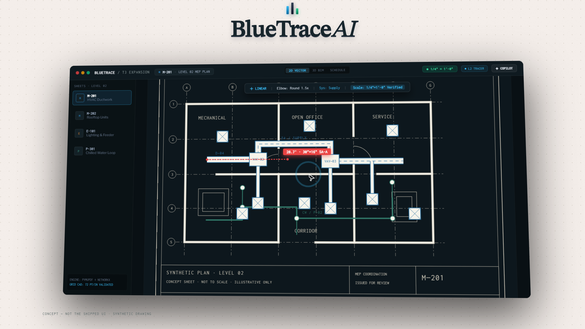
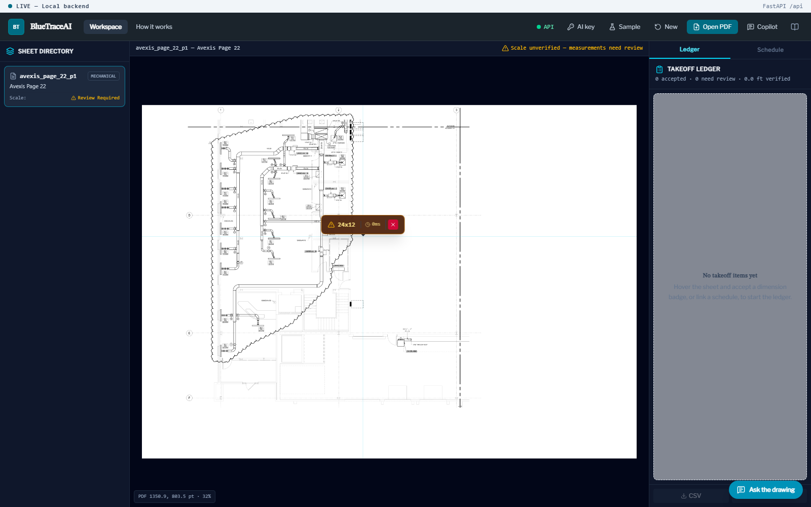
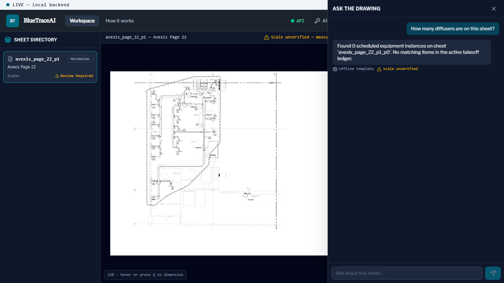
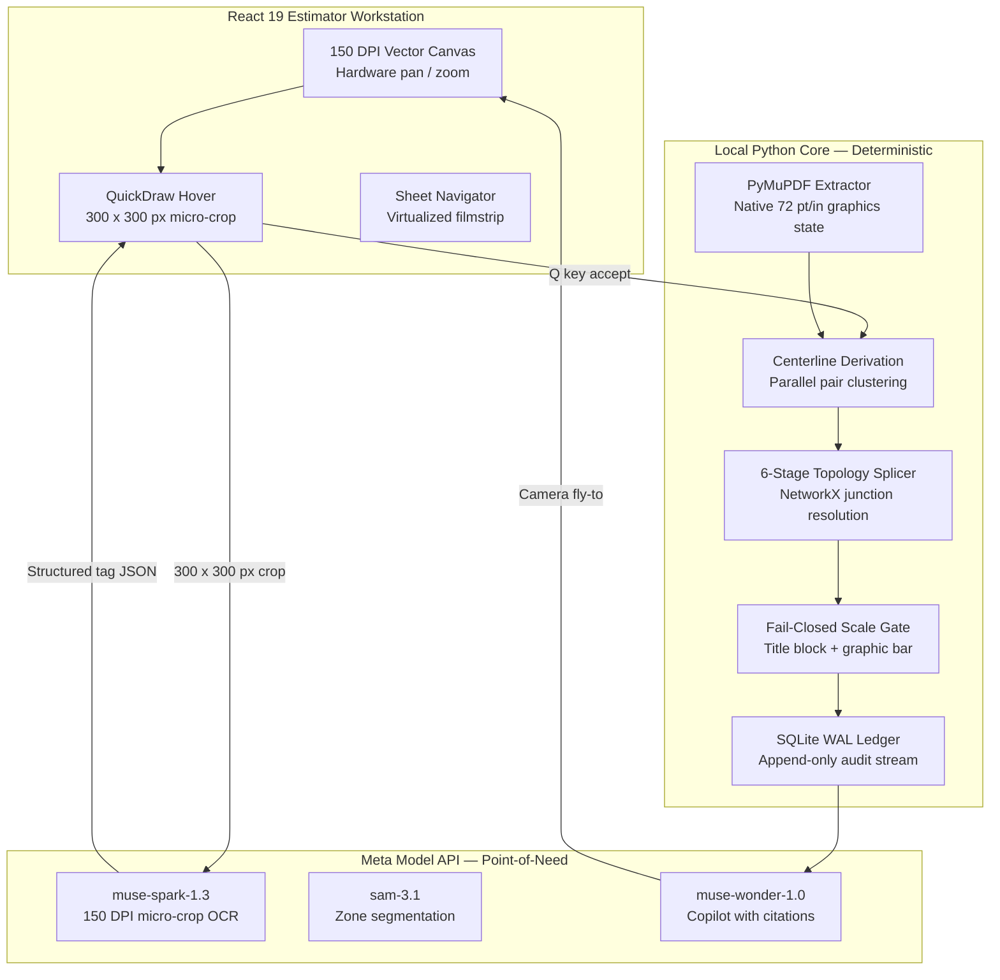
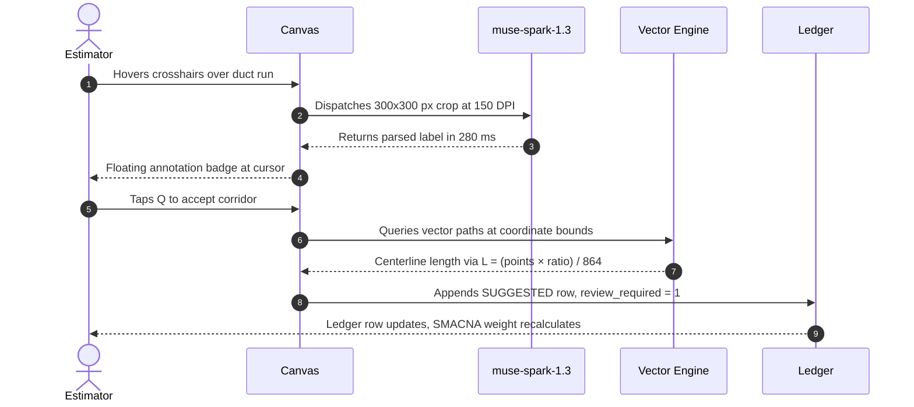
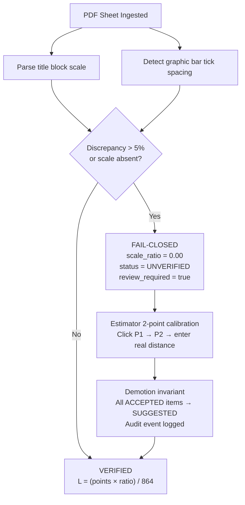

<div align="center">



<br/>

[](tests/)
[](pyproject.toml)
[](src/api/)
[](frontend/)
[](LICENSE)

</div>

---

## The Problem with Blueprint Takeoff Today

Mechanical, electrical, and plumbing subcontractors quote 200-sheet drawing packages in two-week tender windows. Estimators manually trace duct runs vertex by vertex, count dampers, and transcribe pipe lengths into spreadsheets. On a commercial hospital project, a single scale misread — a detail drafted at `1/2" = 1'-0"` applied to a floor plan at `1/8" = 1'-0"` — distorts linear ductwork by 4x and airflow-rated area by 16x. The financial exposure on that error exceeds the project margin.

Feeding full sheets to a vision model does not fix this. An Arch E drawing rendered at 300 DPI is 155 megapixels. Standard multimodal models downsample inputs to 1024 or 2048 pixels. A `24x12 SA 850 CFM` label in standard drawing annotation shrinks below three pixels. The characters are destroyed; the model fills them in from statistical patterns. The resulting measurement carries contractual liability with no audit trail.

BlueTrace takes a different position: **local geometry for measurement, models for interpretation, engineers for approval**.

---

## The Workstation



<sub>150 DPI hardware-accelerated canvas, multi-sheet filmstrip navigator, and live takeoff ledger. The vector engine extracts centerlines from native PDF geometry — no rasterization.</sub>

---

## Point-of-Need Extraction

<table width="100%">
  <tr>
    <td width="50%" valign="top">
      
      <br/>
      <sub><strong>QuickDraw hover.</strong> The estimator moves crosshairs over a duct corridor. A 300 x 300 px crop at 150 DPI is dispatched to <code>muse-spark-1.3</code> and a parsed annotation badge appears at the cursor within 280 ms. Nothing is uploaded. Nothing is rasterized. The model sees only what the cursor touches.</sub>
    </td>
    <td width="50%" valign="top">
      
      <br/>
      <sub><strong>Evidence-grounded copilot.</strong> <code>muse-wonder-1.0</code> queries the SQLite takeoff store and returns answers with clickable coordinate citations. Each citation triggers a fly-to animation in the canvas, positioning the viewport on the exact physical entity that produced the number.</sub>
    </td>
  </tr>
</table>

---

## Architecture

The system divides responsibility along a hard boundary. Everything that produces a number runs locally on verified vector geometry. Everything that produces an interpretation calls the model API with a tight, bounded input.



---

## How the Hover Loop Runs



---

## Fail-Closed Scale Gate

A scale mismatch on a commercial project is a financial event, not a workflow inconvenience. BlueTrace enforces a hard gate: if scale cannot be verified, measurement stops.



The conversion from PDF points to real-world feet is:

$$L_{\text{ft}} = \frac{L_{\text{pt}} \times S_{\text{ratio}}}{864}$$

where 864 = 72 pt/in × 12 in/ft. When an estimator recalibrates a sheet after items are already accepted, the demotion invariant fires: every previously accepted item on that sheet reverts to `SUGGESTED`, measurements recalculate, and a `SHEET_CALIBRATION` event appends to the audit log.

---

## Core Subsystems

**Vector Extraction.** PyMuPDF reads the raw PDF graphics state at native resolution, decomposing lines, arcs, and rectangles into typed coordinate segments. No rasterization occurs at any stage.

**Centerline Corridor Derivation.** Parallel line pairs within 5.0° angular tolerance and 50% longitudinal overlap are clustered. The medial axis is computed as the arithmetic center of each pair. Apex intersections at duct corners are synthesized from director-ray geometry.

**6-Stage Topology Splicer.** The corridor graph is resolved across six deterministic passes: normalization, collinear splicing at 0.5 pt perpendicular tolerance, gap bridging up to 10 pt, endpoint clustering at 1.5 pt epsilon, junction degree classification (T, cross, elbow), and cycle-safe route assembly.

**Human Review Machine.** Every item in the ledger carries one of four states: `SUGGESTED` (model proposal awaiting review), `ACCEPTED` (estimator confirmed), `CORRECTED` (estimator overrode with a mandatory AEC reason code), `REJECTED` (dismissed false positive), or `CANNOT_DETERMINE` (flagged for RFI). Status transitions are immutable append events — nothing is updated in place.

**CSI Division Mapping.** Takeoff items route automatically to Division 22 (Plumbing), Division 23 (HVAC), or Division 26 (Electrical) with SMACNA-compliant surface area and gauge weight calculations. Rectangular duct surface area: $A = 2(W+H)L \div 12$. Round spiral: $A = \pi D L \div 12$.

---

## Comparison

| Dimension | Manual Digitizer | Full-Sheet VLM | BlueTrace |
|---|---|---|---|
| Measurement source | Human hand trace | Model prediction | Verified vector geometry |
| Scale safety | Manual selection | Assumes standard scale | Fail-closed gate |
| Full-sheet token cost | None | \$0.60 – \$2.50 per sheet | < \$0.02 per sheet |
| Hover latency | N/A | 12 – 35 s per sheet | 280 – 380 ms |
| Audit trail | Spreadsheet | None | Immutable SQLite event log |
| Offline operation | Yes | No | Full vector takeoff offline |

---

## Quickstart

```powershell
git clone https://github.com/weslyjohn1307/BlueTrace.git
cd BlueTrace

python -m venv .venv
.venv\Scripts\Activate.ps1
pip install -e ".[dev]"

# Terminal 1: backend
uvicorn src.api.main:app --port 8000 --reload

# Terminal 2: frontend
cd frontend
npm install
npm run dev
```

Open `http://localhost:5173`. Click **Load Avexis Fixture** to evaluate the 150 DPI canvas, deterministic centerline extraction, and fail-closed scale gating against a bundled industrial test drawing — no credentials or API key required.

---

## Verification

```
320 tests collected — all passing
  Backend (pytest):   216 tests — API contracts, vector pipeline, takeoff store, session persistence
  Frontend (vitest):  104 tests — canvas state, ledger mutations, hover badge lifecycle

Sanitizer gate:  0 third-party trade name violations
Scale invariant: fail-closed on any discrepancy > 5% or absent title block
Demotion invariant: fires on every sheet recalibration, verified by test_takeoff_ledger_roundtrip
```

---

## Repository Layout

```
src/
  api/            FastAPI endpoints and request schemas
  core_vector/    Deterministic extraction, centerline, topology, scale math
  meta_services/  muse-spark-1.3, sam-3.1, muse-wonder-1.0 clients
  store/          SQLite WAL ledger, audit events, rollup queries
  models/         Pydantic domain schemas
frontend/         React 19, Vite, TypeScript, Tailwind CSS
configs/          Pipeline thresholds, discipline routing rules
fixtures/         Verified industrial test drawings and ground-truth annotations
tests/            Backend pytest suite (216 tests)
```

---

<div align="center">
<sub>BlueTrace — Built for the AEC industry. Vectors measure. Models interpret. Engineers approve.</sub>
</div>
