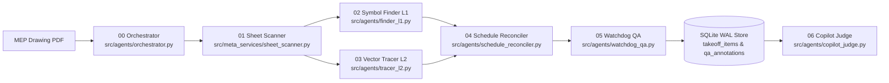

<p align="center">
  <a href="https://weslyjohn1307.github.io/BlueTrace/">
    <picture>
      <source media="(prefers-color-scheme: dark)" srcset="docs/assets/brand/bluetrace-logo-dark.svg">
      <source media="(prefers-color-scheme: light)" srcset="docs/assets/brand/bluetrace-logo-light.svg">
      
    </picture>
  </a>
</p>

<p align="center">
  <strong>MEP drawing review, grounded in the sheet.</strong><br>
  Deterministic Vector Linework &bull; Meta Foundation Models &bull; Human-in-the-Loop Takeoff Store
</p>

<p align="center">
  <a href="https://github.com/weslyjohn1307/BlueTrace/raw/master/docs/assets/BlueTraceAI_Demo.mp4"></a>
  <a href="https://weslyjohn1307.github.io/BlueTrace/"></a>
  <a href="docs/SUBMISSION.md"></a>
  <a href="#run-locally"></a>
  <a href="LICENSE"></a>
</p>

<p align="center">
  <a href="https://github.com/weslyjohn1307/BlueTrace/raw/master/docs/assets/BlueTraceAI_Demo.mp4"><strong>Watch Master Demo Video (2 min)</strong></a> &bull;
  <a href="https://weslyjohn1307.github.io/BlueTrace/"><strong>Interactive Concept Walkthrough</strong></a> &bull;
  <a href="docs/SUBMISSION.md"><strong>Submission Story</strong></a> &bull;
  <a href="#run-locally"><strong>Run Locally</strong></a> &bull;
  <a href="#how-it-works"><strong>Architecture</strong></a> &bull;
  <a href="#evaluation-and-verification"><strong>Evaluation</strong></a>
</p>

---

<p align="center">
  <a href="https://github.com/weslyjohn1307/BlueTrace/raw/master/docs/assets/BlueTraceAI_Demo.mp4">
    
  </a>
</p>
<p align="center">
  ▶️ <strong><a href="https://github.com/weslyjohn1307/BlueTrace/raw/master/docs/assets/BlueTraceAI_Demo.mp4">Click to Watch Master Demonstration Film (2:00 min • 1080p • Voiceover Narration)</a></strong>
</p>

BlueTraceAI is an AI-native takeoff workstation built for mechanical, electrical, and plumbing (MEP) estimators. Submitted to the **Meta Global AI Developer Hackathon** (**Indie Developer Track: Push the Frontier**). 

Estimators spend 30 to 40 hours per project manually measuring duct runs and counting fixtures across dense blueprints. General vision AI models fail on blueprints because downsampling large-format sheets destroys micro-text callouts, and generative models guess measurements rather than calculating them.

BlueTraceAI solves this through a **hybrid division of labor**:
- **Meta Foundation Models** interpret visual context and read text callouts at the point of need.
- **Deterministic Python Geometry** extracts vector paths and calculates exact physical lengths from validated drawing scales.
- **The Human Estimator** retains complete sovereignty to accept, correct, or reject every quantity.

---

## How It Works

BlueTraceAI separates visual interpretation from mathematical measurement so every quantity remains grounded in the physical sheet:

<p align="center">
  
</p>

1. **Intake & Title Block Reconnaissance:** Parses native PDF text, identifies sheet numbers and trade disciplines, and extracts scale candidates (`POST /api/intake/batch`).
2. **Point-of-Need Vision:** Rather than downsampling full sheets, the workstation sends high-resolution 150 DPI crops ($300 \times 300\text{ px}$) around the cursor to Meta `muse-spark-1.3` to extract duct dimensions, tags, and airflow notes in sub-350ms.
3. **Deterministic Vector Geometry:** PyMuPDF extracts raw PDF vector paths without rasterization loss; Shapely pairs parallel walls to compute medial-axis centerlines; NetworkX reconstructs duct run continuity. Point lengths convert to linear feet using validated scale ratios:
   $$L_{\text{ft}} = \frac{L_{\text{pt}} \times S_{\text{ratio}}}{864}$$
4. **Fail-Closed Scale Rule:** If a drawing lacks a scale or has conflicting scale callouts, the system flags `scale_ratio = 0.0` and `review_required = True`. Measurements remain safely blocked until two-point calibration is confirmed.
5. **Human-in-the-Loop Takeoff Ledger:** Proposed items enter a local SQLite store as `SUGGESTED`. Estimators review items on canvas with single-keystroke hotkeys (`A` to accept, `R` to reject, `C` to correct) and export verified CSV bid schedules.

> **Core Invariant:** Meta models interpret visual and language context; they never guess physical lengths. Scale-dependent measurement belongs to local vector geometry. The human estimator decides what enters the commercial bid.

---

## What Is in the Application

<table>
  <tr>
    <td width="50%" valign="top">
      <a href="https://github.com/weslyjohn1307/BlueTrace/raw/master/docs/assets/BlueTraceAI_Demo.mp4"></a>
      <p><strong>Multi-Discipline Layer Decomposition.</strong> Lifts overlapping engineering schematics onto separated transparent planes: HVAC ductwork (Division 23), Electrical (26), Plumbing (22), and Architectural background.</p>
    </td>
    <td width="50%" valign="top">
      <a href="https://github.com/weslyjohn1307/BlueTrace/raw/master/docs/assets/BlueTraceAI_Demo.mp4"></a>
      <p><strong>Point-of-Need QuickDraw.</strong> Drag along a duct corridor; Meta <code>muse-spark-1.3</code> extracts dimensions (<code>30x16 SA-A</code>) from 150 DPI crops in &lt;350ms, while vector geometry computes true physical footage.</p>
    </td>
  </tr>
  <tr>
    <td width="50%" valign="top">
      <a href="https://github.com/weslyjohn1307/BlueTrace/raw/master/docs/assets/BlueTraceAI_Demo.mp4"></a>
      <p><strong>Evidence-Grounded Copilot-Judge.</strong> Ask natural-language estimating questions; Meta <code>muse-wonder-1.0</code> queries the local SQLite ledger and cites exact drawing coordinates (<code>ev:M-201:duct:1420:850</code>) that pan the sheet.</p>
    </td>
    <td width="50%" valign="top">
      <a href="https://github.com/weslyjohn1307/BlueTrace/raw/master/docs/assets/BlueTraceAI_Demo.mp4"></a>
      <p><strong>Estimator Takeoff Ledger & Export.</strong> Single-keystroke review hotkeys (<code>A</code> to accept, <code>R</code> to reject, <code>C</code> to correct) with immutable SQLite audit events, SMACNA pressure class grouping, and verified CSV exports.</p>
    </td>
  </tr>
</table>

---

## Multi-Agent Workflow

The hackathon extension coordinates drawing reconnaissance, symbol finding, vector tracing, schedule reconciliation, quality checks, and copilot verification across seven product-plane agent modules (`src/agents/`):



| Agent | Module | Responsibility |
|---|---|---|
| **00 Orchestrator** | `src/agents/orchestrator.py` | Routes sheets by type (`PLAN`, `LEGEND`, `SCHEDULE`), assigns deterministic `ev:<sheet>:<type>:<x>:<y>` evidence IDs, and logs per-stage execution traces (`POST /api/agents/orchestrate`). |
| **01 Sheet Scanner** | `src/meta_services/sheet_scanner.py` | Extracts sheet numbers, disciplines, and scale candidates, and enforces the fail-closed scale gate (`src/core_vector/pipeline.py`). |
| **02 Symbol Finder (L1)** | `src/agents/finder_l1.py` | Parses legend exemplars first (`src/meta_services/legend_scanner.py`), tiles plan sheets at 150 DPI ($1024\text{ px}$ tiles with $128\text{ px}$ overlap), and deduplicates symbol boxes via class-aware NMS (`src/meta_services/symbol_swarm.py`). |
| **03 Vector Tracer (L2)** | `src/agents/tracer_l2.py` | Extracts native PDF vector segments, pairs parallel walls into centerline corridors, splits T-junctions, and caches geometry by file SHA-256 (`src/core_vector/`). |
| **04 Schedule Reconciler** | `src/agents/schedule_reconciler.py` | Reconciles schedule equipment tags against plan symbol counts (`src/store/reconciler.py`) and emits candidate ghost pins or mismatch flags without silently altering quantities. |
| **05 Watchdog QA** | `src/agents/watchdog_qa.py` | Runs deterministic rule checks for uncalibrated scales, schedule-vs-plan mismatches, and unreviewed items, persisting durable `qa_annotations`. |
| **06 Copilot Judge** | `src/agents/copilot_judge.py` | Executes read-only SQLite tool queries (`src/agents/tools.py`), verifies that every `ev:` citation resolves to a stored entity, and discloses unverified sheet scales. |

---

## Meta Models

BlueTraceAI uses Meta models (`https://api.meta.ai/v1`) for visual interpretation and grounded reasoning over MEP drawings. Local Python code owns PDF vector geometry, scale math, and transactional storage.

| Model | Role in the project | Live API behavior (`MODEL_API_KEY` set) | Offline / unconfigured behavior |
|---|---|---|---|
| **Muse Spark 1.3** (`muse-spark-1.3`) | Vision and OCR for 150 DPI cursor crops, title blocks, legend exemplars, and schedule tables (`src/meta_services/client.py`). | Sends cropped PNG/WebP regions for structured tag, dimension, and table extraction. | Crop OCR and schedule parsing return labeled offline stubs (`mock = True`, `confidence = 0.0`, `review_required = True`); legend scanning abstains with `NO_LEGEND_FOUND`. |
| **Muse Wonder 1.0** (`muse-wonder-1.0`) | Copilot reasoning and citation synthesis over SQLite takeoff evidence (`src/meta_services/copilot.py`, `src/agents/copilot_judge.py`). | Synthesizes natural-language answers from read-only SQLite tool results with verified `ev:` citations. | Returns deterministic local SQLite evidence summaries (`offline = True`) with verified coordinate citations. |
| **SAM 3.1** (`sam-3.1`) | Region and symbol boundary segmentation via `/v1/responses` (`src/meta_services/client.py`). | Returns segmentation polygon masks for selected drawing regions. | Abstains with an empty polygon list (`polygons = []`, `confidence = 0.0`, `review_required = True`) rather than fabricating geometry. |

> **Offline Integrity:** Live model calls require `MODEL_API_KEY` and network access. Without a key, the application runs locally; model-dependent endpoints return clearly labeled offline responses or abstain fail-closed. Offline output is never presented as live Meta inference.

---

## Run Locally

The standalone launcher serves the compiled React 19 frontend and FastAPI application on a single local port. It builds `frontend/dist` automatically if the production bundle is missing.

**Prerequisites:** Windows (tested in CI on `windows-latest`), Python 3.10–3.13, Node.js 24, and npm.

```powershell
# 1. Clone repository
git clone https://github.com/weslyjohn1307/BlueTrace.git
cd BlueTrace

# 2. Setup Python virtual environment
py -3 -m venv .venv
.\.venv\Scripts\python.exe -m pip install -e ".[dev]"

# 3. Install frontend dependencies
npm --prefix frontend ci

# 4. Start standalone server (Backend + Frontend on Port 8000)
.\.venv\Scripts\python.exe scripts/start_standalone.py
```

Open `http://localhost:8000` in your browser. The interactive OpenAPI reference is served at `http://localhost:8000/docs`, and `GET /api/health` returns `{"status": "ok"}`.

To enable live Meta requests, copy `.env.example` to `.env` and set `MODEL_API_KEY` there, or supply a session-scoped key through the in-app **API Key (BYOK)** modal (`POST /api/auth/byok`). Keep credentials out of source files and `VITE_*` frontend build variables.

<details>
<summary><strong>Alternative setup: dual-terminal development & desktop sidecar packaging</strong></summary>

**Dual-terminal development servers:**

```powershell
# Terminal 1: FastAPI backend with auto-reload on port 8000
.\.venv\Scripts\python.exe -m uvicorn src.api.main:app --port 8000 --reload

# Terminal 2: Vite development server on port 5173
npm --prefix frontend run dev
```

**Desktop sidecar packaging validation (PyInstaller + Tauri v2):**

```powershell
# Verify PyInstaller sidecar spec and required hidden imports
.\.venv\Scripts\python.exe scripts/build_sidecar.py --dry-run

# Verify Tauri v2 configuration, NSIS installer hooks, and Ed25519 updater keys
.\.venv\Scripts\python.exe scripts/validate_packaging_manifest.py
```

</details>

---

## Evaluation and Verification

Repository fixtures in `fixtures/mechanical/` provide reproducible local verification of vector extraction, coordinate tiling, schedule reconciliation, watchdog rules, and fail-closed offline behavior (`docs/EVAL_REPORT.md`):

| Verification target | Fixture / input | Measured result | Command |
|---|---|---|---|
| **Vector centerline extraction** | `fixtures/mechanical/hvac_plan_level2.pdf` (Page 22 mechanical plan) | **329** extracted centerline runs vs. **329** ground-truth runs (`0.00%` count error; `636.62 ft` calibrated at $1/8" = 1'-0"$, `0.00 ft` when uncalibrated) | `.\.venv\Scripts\python.exe scripts/generate_eval_report.py` |
| **Geometry SHA-256 cache** | `fixtures/mechanical/hvac_plan_level2.pdf` | Warm cache lookup in `< 2.0 ms` (`1.35 ms` recorded vs. `23.47 s` cold 6-stage topological extraction) | `.\.venv\Scripts\python.exe scripts/generate_eval_report.py` |
| **Tiling coordinate round-trip** | `hvac_schedule_plan_gt.json` (168 boxes) & `hvac_plan_level2_gt.json` (21 boxes) | `0.000000 pt` max untile drift (`<= 0.50 pt` gate); `0` fabricated items in offline mode | `.\.venv\Scripts\python.exe scripts/generate_eval_report.py` |
| **Schedule & watchdog gates** | Seeded schedule-vs-plan fixture | `1.00` mismatch recall (`1` matched, `1` ghost pin, `2` mismatch flags); durable `qa_annotations` persisted | `.\.venv\Scripts\python.exe scripts/generate_eval_report.py` |

Run the test, lint, type-check, and sanitizer suites:

```powershell
.\.venv\Scripts\python.exe -m pytest tests/ -q
.\.venv\Scripts\python.exe -m ruff check src/ tests/ scripts/
.\.venv\Scripts\python.exe -m mypy
.\.venv\Scripts\python.exe scripts/sanitize_import.py --audit
npm --prefix frontend run test -- --run
npm --prefix frontend run lint
npm --prefix frontend run build
```

---

## Project Status

**Active prototype.** The 150 DPI drawing workspace, deterministic vector centerline engine, fail-closed scale governance, SQLite WAL takeoff store, seven-agent orchestration pipeline, standalone single-port server, and Tauri v2 + PyInstaller sidecar packaging configuration are implemented in this repository and tested in CI across Python 3.10–3.13 and Node.js 24.

**Known limitations and boundaries:**

- **Not an autonomous bidding system:** Estimators must verify drawing context, scale calibration, and quantities before relying on a takeoff for commercial bidding.
- **Native vector PDF requirement for centerline geometry:** Automatic wall pairing and centerline length extraction require PDF drawings exported with vector primitives (such as AutoCAD, Revit, or MagiCAD exports). Scanned raster-only blueprints contain no vector paths and trigger `review_required = True` with `scale_ratio = 0.0` for manual calibration and review.
- **Live Meta API credentials required for cloud perception:** Without `MODEL_API_KEY`, the deterministic vector pipeline, scale calibration, ledger review state machine, watchdog rules, and CSV/JSON exports operate offline, while model-backed OCR, legend vision, segmentation, and copilot synthesis return labeled offline responses or abstain fail-closed.
- **Single-node local persistence:** Takeoff data is stored locally in an SQLite WAL database (`data/bluetrace.db`). Multi-user cloud synchronization is not implemented.

---

## Data and Credentials

The application stores project metadata, sheet records, takeoff items, review events, and QA annotations in a local SQLite database (`data/bluetrace.db`). Uploaded PDFs and cached thumbnails stay on the local disk under `data/` (gitignored).

When a live Meta feature is invoked with `MODEL_API_KEY` configured, the submitted drawing crop, legend region, schedule image, or copilot prompt is sent to the Meta Model API (`https://api.meta.ai/v1`) for processing. Only use project drawings with the permissions required by your organization. Engineer correction crops recorded via `POST /api/feedback/events` are stored locally with `training_eligible = 0` by default. Supply API keys only to the backend via `.env` or the session-scoped BYOK endpoint; never place keys in a `VITE_*` variable or commit them to the repository.

---

## Documentation

- [Hackathon Submission Story](docs/SUBMISSION.md)
- [Privacy Policy](docs/PRIVACY.md)
- [Terms & Conditions](docs/TERMS.md)
- [Product Vision](docs/PRODUCT-VISION.md)
- [Implemented UI Flows](docs/specs/UI-UX-FLOWS.md)
- [Fixture Evaluation Report](docs/EVAL_REPORT.md)
- [REST & SSE API Reference](docs/API_REFERENCE.md)
- [Operator Runbook & Data Retention Guide](docs/RUNBOOK.md)
- [Hybrid MEP Architecture Decision (ADR-001)](docs/adr/ADR-001-hybrid-mep-architecture.md)
- [Offline Engine Reuse & Point-of-Need UX (ADR-002)](docs/adr/ADR-002-reusing-offline-engine-and-point-of-need-ux.md)
- [VLM Detection & Legend-First Architecture (ADR-003)](docs/adr/ADR-003-vlm-detection-replaces-yolo.md)
- [Standalone Single-Port Launcher](scripts/start_standalone.py)
- [Meta API Configuration Example](.env.example)

---

## License

BlueTraceAI is available under the [Apache License 2.0](LICENSE).
