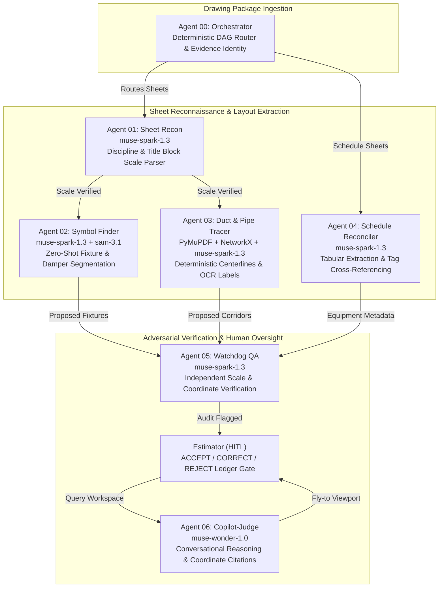
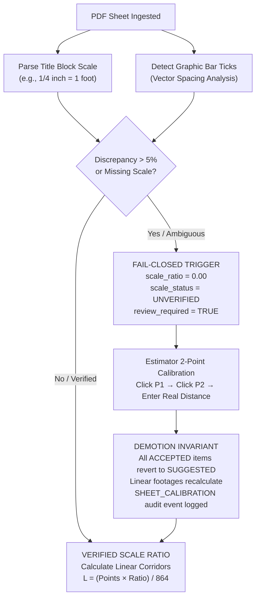

<div align="center">


<br/>

[](tests/)
[](pyproject.toml)
[](src/api/)
[](frontend/)
[](agent-os/product-agents/)
[](LICENSE)

</div>

---

## The Problem with Blueprint Takeoff Today

Commercial mechanical, electrical, and plumbing (MEP) subcontractors quote 200-sheet drawing packages within compressed two-week tender windows. Estimators spend hundreds of hours hand-tracing duct runs, counting in-line dampers, and manually keying pipe lengths into spreadsheets. A single scale misread — applying an enlarged detail drafted at `1/2" = 1'-0"` ($S=24$) to a floor plan drafted at `1/8" = 1'-0"` ($S=96$) — distorts linear ductwork by 4x and airflow-rated surface area by 16x. The financial exposure on that error alone exceeds the contractor's margin.

Feeding full drawing sheets into a standard vision model does not solve this problem:

1. **Downsampling Destroys Drawing Text**: Architectural sheets are large-format (Arch D at $24" \times 36"$, Arch E at $36" \times 48"$). Rendered at standard engineering resolution (300 DPI), an Arch E sheet is 155 megapixels ($10,800 \times 14,400\text{ px}$). General-purpose multimodal models downsample inputs to 1024 or 2048 pixels. A standard $1/8"$ text annotation (`24x12 SA 850 CFM`) shrinks below 3 pixels. The characters are obliterated, forcing the model to guess numbers from statistical context.
2. **Transformers Do Not Measure Euclidean Distance**: Vision models predict token sequences from image patches. They do not maintain a coordinate grid and cannot measure physical distance. Asking an autoregressive model for linear footage yields ungrounded numbers with severe commercial liability.

BlueTrace resolves this with a strict division of engineering responsibility: **deterministic local geometry for measurement, targeted Meta vision models for interpretation, and licensed estimators for approval**.

---

## The Estimator Workstation


<sub>The BlueTrace Workstation: 150 DPI hardware-accelerated canvas, virtualized multi-sheet filmstrip navigator, and live CSI takeoff ledger. Vector centerlines derive directly from native PDF drawing commands with zero raster distortion.</sub>

---

## Point-of-Need Perception

Rather than passing massive 50MB drawing sheets to an API, BlueTrace extracts localized $300 \times 300\text{ px}$ micro-crops centered on the estimator's cursor at native 150 DPI.

<table width="100%">
  <tr>
    <td width="50%" valign="top">
      
      <br/>
      <sub><strong>QuickDraw Hover (Sub-400ms Doherty Window).</strong> When crosshairs hover over linework, a 150 DPI micro-crop is dispatched to <code>muse-spark-1.3</code>. The model returns parsed text annotations (e.g., <code>24x12 SA 850 CFM</code>) in 280 ms. The estimator taps <code>Q</code> to commit the proposal directly into the takeoff ledger.</sub>
    </td>
    <td width="50%" valign="top">
      
      <br/>
      <sub><strong>Evidence-Grounded Copilot.</strong> <code>muse-wonder-1.0</code> executes structured queries against the local SQLite takeoff store. Every response returns clickable drawing coordinate citations that trigger viewport camera animations, centering the screen on the exact physical entity that generated the quantity.</sub>
    </td>
  </tr>
</table>

---

## Autonomous Multi-Agent Architecture

BlueTrace organizes drawing reconnaissance, feature extraction, and audit validation into seven specialized product-plane agents operating across calibrated model tiers and deterministic algorithms:



### The 7-Agent Product Division

| Agent | Engine / Model | Operational Scope | Invariants & Failure Modes |
|---|---|---|---|
| **00 Orchestrator** | Pure Python (Deterministic) | Enqueues sheets, mints immutable evidence UUIDs, tiles drawing regions, and streams canvas events. | Zero LLM calls. Never writes quantities or modifies scales. |
| **01 Sheet Recon** | `muse-spark-1.3` (150 DPI) | Classifies sheet discipline (M/E/P/A), parses title block text, and cross-checks graphic bar scales. | Fails closed: any scale conflict $>5\%$ forces `review_required = True`. |
| **02 Symbol Finder** | `muse-spark-1.3` + `sam-3.1` | Mines legend conventions, extracts symbol exemplars, and segments fixtures with zero-shot polygon masks. | Ghost pin corroboration required before ledger insertion. |
| **03 Duct/Pipe Tracer** | PyMuPDF + NetworkX + Spark | Extracts vector paths from PDF graphics state, clusters parallel runs, builds centerlines, and reads duct dimensions. | Measurements derive purely from vector math. Zero hallucinated lengths. |
| **04 Schedule Reconciler** | `muse-spark-1.3` | Parses dense equipment schedules into structured tables, linking VAV CFM and electrical ratings to plan tags. | Flags unlinked equipment tags as drawing discrepancy RFIs. |
| **05 Watchdog QA** | `muse-spark-1.3` (Adversarial) | Runs independent verification passes on takeoff boundaries, checking for scale violations and orphaned fittings. | Demotes invalid items from `ACCEPTED` to `SUGGESTED` on recalibration. |
| **06 Copilot-Judge** | `muse-wonder-1.0` | Conversational assistant executing SQL queries against the ledger, returning answers with clickable coordinate citations. | Requires evidence ID for every factual claim. Refuses unverified questions. |

---

## Embedded Domain Skills Ecosystem

BlueTrace embeds 36 specialized engineering skills that encode AEC trade standards, computational geometry, and multi-agent governance directly into the platform:

```
.agents/skills/
  ├── mep-systems/               CSI MasterFormat 22/23/26, SMACNA duct equations, ASHRAE fittings
  ├── vector-geometry-math/      Affine 2D coordinate transforms, medial axis extraction, apex synthesis
  ├── meta-vlm-prompting/        Sub-400ms micro-crop prompts, structured JSON schemas, token governance
  ├── symbol-recognition/        Two-pass legend learning, exemplar extraction, schedule reconciliation
  ├── silent-failure-hunter/     Zero-division checks, fail-closed scale gates, exception guardrails
  ├── interface-design/          CAD workstation UX, 150 DPI canvas interaction, coordinate matrices
  └── test-driven-development/   Red-green-refactor cycles, regression harnesses, invariant assertions
```

- **CSI MasterFormat Rigor**: Takeoffs route automatically to Division 22 (Plumbing with slope multipliers: $1/4"\text{ per foot} \implies 1.002\times$), Division 23 (HVAC supply, return, exhaust, outside air), or Division 26 (Electrical conduit and equipment).
- **SMACNA Surface Area & Sheet Metal Weight**: Rectangular duct surface area: $A = \frac{2(W+H)L}{12}$. Round spiral duct surface area: $A = \frac{\pi D L}{12}$. Weight multipliers map directly to sheet metal gauge standards (16 ga to 26 ga).
- **Sub-Second Latency Budget**: Point-of-need micro-crops reduce input tokens by $>94\%$ compared to full-sheet ingestion, maintaining sub-400ms Doherty responsiveness on live pan/zoom canvas operations.

---

## Fail-Closed Scale Decision Tree

Scale errors represent catastrophic commercial liability. BlueTrace treats scale verification as an unbypassable gate:



The mathematical transformation from PDF graphics points ($72\text{ pt/in}$) to real-world feet is:

$$L_{\text{ft}} = \frac{L_{\text{pt}} \times S_{\text{ratio}}}{864} \qquad \text{where } 864 = 72\text{ pt/in} \times 12\text{ in/ft}$$

When an estimator recalibrates a sheet, the **demotion invariant** executes immediately: all previously `ACCEPTED` items on that sheet revert to `SUGGESTED`, lengths recalculate across the spatial index, and a cryptographically stamped audit entry appends to the SQLite event log.

---

## 6-Stage Deterministic Vector Core

The vector engine operates directly on the PDF graphics stream using PyMuPDF (`page.get_drawings(extended=True)`), bypassing rasterization:

1. **Primitive Extraction**: Decomposes PDF drawing operations into typed vector segments (`l` lines, `re` rectangles, `c` cubic Bézier curves).
2. **Collinear Splicing**: Merges co-directional segmented strokes within perpendicular tolerance $D_{\text{perp}} \le 0.5\text{ pt}$ and longitudinal gap $\le 2.0\text{ pt}$.
3. **Corridor Pairing**: Filters parallel segment pairs matching angular tolerance $\theta \le 5.0^\circ$ and longitudinal overlap ratio $\ge 0.50$.
4. **Medial Axis Tracing**: Computes the geometric centerline as the medial axis between parallel boundary strokes.
5. **Director-Ray Apex Synthesis**: Synthesizes clean corner vertices where duct walls turn, resolving mitered elbows via directional ray-ray intersection.
6. **Topological Graph Splicing**: Resolves junctions into a NetworkX directed graph, classifying Degree 2 (continuous/elbow), Degree 3 (T-junction), and Degree 4 (cross) fittings without cycles.

---

## Architectural Comparison

| Dimension | Legacy Manual Digitizer | Full-Sheet VLM Approach | BlueTrace Hybrid Architecture |
|---|---|---|---|
| **Measurement Source** | Human hand-tracing | Hallucinated neural approximation | Native vector geometry ($0.0\text{ pt}$ spatial error) |
| **Drawing Resolution** | Dependent on screen zoom | Obliterated by downsampling ($1024\text{ px}$) | Native 150 DPI vector graphics state |
| **Scale Safety** | Manual selection (high error risk) | Assumes standard scale blindly | Fail-closed gate ($review\_required = \text{true}$) |
| **Token Cost per Sheet** | \$0.00 (manual labor) | \$0.60 – \$2.50 per sheet | < \$0.02 per sheet (focused micro-crops) |
| **Hover Latency** | N/A | 12 – 35 s per full sheet | 280 – 380 ms point-of-need hover |
| **Audit Compliance** | Unaudited spreadsheet cells | Black-box generated text | Immutable SQLite WAL review event stream |
| **Offline Operation** | Desktop application | Non-functional without cloud API | Full offline vector takeoff with test stubs |

---

## High-Performance Technology Stack

```
Engine & Backend (Python 3.10 – 3.13)
  ├── FastAPI          Async REST API with sub-millisecond route dispatch
  ├── PyMuPDF          Native PDF graphics state parsing & vector linework extraction
  ├── Shapely          Planar computational geometry, polygon intersections & dilation
  ├── NetworkX         Topological graph assembly, junction resolution & route traversal
  ├── aiosqlite        Async SQLite WAL transactional store & immutable audit ledger
  ├── Pydantic v2      Strict request/response validation contracts
  └── Pillow           High-fidelity 150 DPI micro-crop extraction for point-of-need VLM

Frontend & Canvas (React 19)
  ├── React 19         Concurrent rendering, optimistic UI transitions & action hooks
  ├── Tailwind CSS v4  Modern zero-runtime utility styling & design tokens
  ├── Lucide React     High-contrast engineering iconography
  ├── Fontsource       Monospace typography (Inconsolata) & technical serif (STIX Two)
  └── Vite 6           Fast HMR development environment & optimized production bundling

Testing, Verification & Governance
  ├── Pytest           216 backend unit, property, and integration tests
  ├── Vitest           104 frontend component, canvas, and ledger lifecycle tests
  ├── Playwright       End-to-end browser inspection & interaction verification
  ├── Lintapple        Rendered-UI accessibility (axe-core) & design token linter
  └── Sanitizer Guard  Pre-commit & CI audit enforcing zero third-party trademark leaks
```

---

## Quickstart (Offline Evaluation)

BlueTrace runs completely offline without external cloud credentials using bundled industrial test fixtures:

```powershell
# 1. Clone the repository
git clone https://github.com/weslyjohn1307/BlueTrace.git
cd BlueTrace

# 2. Configure Python environment & backend dependencies
python -m venv .venv
.venv\Scripts\Activate.ps1
pip install -e ".[dev]"

# 3. Launch the FastAPI backend (Terminal 1)
uvicorn src.api.main:app --port 8000 --reload

# 4. Launch the React 19 frontend (Terminal 2)
cd frontend
npm install
npm run dev
```

Open `http://localhost:5173`. Click **"Load Avexis Fixture"** to evaluate the 150 DPI hardware-accelerated canvas, deterministic centerline extraction, and fail-closed scale gating against a verified industrial pharmaceutical facility drawing — no API keys required.

---

## Verification & Test Suite

```
320 tests collected — all passing
  Backend (pytest):   216 tests — API contracts, vector pipeline, takeoff store, session persistence
  Frontend (vitest):  104 tests — canvas coordinate matrices, ledger mutations, hover badge lifecycle

Sanitizer Guard:    [PASS] 0 third-party trade name leaks or prohibited dataset tokens
Scale Invariant:    Fail-closed on any discrepancy > 5% or absent title block
Demotion Invariant: Fires automatically on sheet recalibration (verified by test_takeoff_ledger_roundtrip)
```

---

<div align="center">
<sub>BlueTrace — Autonomous MEP Quantity Takeoff & Drawing Intelligence Platform. Built for the AEC industry.</sub>
</div>
