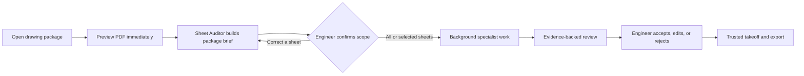

# BlueTrace MEP Engineer Workspace Revamp

**Status:** Design and implementation record; see follow-ups and remaining work  
**Prepared:** 2026-11-04  
**Surface:** The BlueTrace PDF intake, multi-sheet takeoff workspace, and engineer review flow  
**Evidence:** Current React/FastAPI source, the live 7-page plumbing and 25-page mechanical runs, and the browser refresh/layout observations recorded in `fixtures/local_real_testing/README.md`.

**Implementation follow-up:** 2026-11-04 changes and browser verification are appended below. The original findings remain historical evidence; use the follow-up for current frontend status.

## Executive summary

BlueTrace should feel like an engineer opening a drawing package with a capable sheet-audit team beside them. The PDF is the primary work surface. Agents make their progress legible, cite the drawing evidence they used, and ask the engineer only when a decision changes routing, component identity, or a measured quantity. Local vector processing remains deterministic and Meta models assist with visual interpretation, OCR, tables, and grounded copilot responses.

The app already has meaningful pieces: sheet navigation, a pan/zoom canvas, discipline-colored overlays, a takeoff ledger, schedule reconciliation, calibration, QA, copilot, live job events, and fail-closed scale status. The central problem is that these pieces appear as separate controls and technical panels, while upload, classification, long-running work, evidence review, and recovery do not yet read as one coherent engineering workflow.

The recommended redesign is not a decorative dashboard. It is a PDF-first workflow with these stages:



The first implementation slices should address source/job recovery, a real package audit and confirmation step, and a calm workspace layout. Symbol matching, scale semantics, and agent interaction should then be added as evidence-backed vertical slices. The current architecture already supports local geometry and model services; it needs durable job/source identity and clearer contracts between their outputs and the UI.

## What the live project showed

### Measured run evidence

- The 7-page plumbing package completed in **156.58 seconds**. Sheets 2–6 had verified printed scale; sheets 1 and 7 remained unverified. The Finder abstained because it found no usable legend, and no quantities were accepted.
- The 25-page mechanical package completed in **1,131.24 seconds (18m51s)**, with **69 live `muse-spark-1.3` calls**, **225,402 total Meta tokens**, four retries, 25 classified/routed sheets, 2,012 review flags, and 20,275 ledger records. Unverified-scale footage stayed locked at zero.
- Four mechanical sheets had verified printed scale. Other sheets included information, detail, plan, and schedule content; absence of scale cannot be treated as proof that a sheet is not a plan.
- On page 1, eight legend exemplars coexisted with 12 symbol/annotation candidates. Some candidates were references, matchlines, or revision marks instead of countable components. Schedule extraction on page 21 was unparseable. Some mechanical sheets were labeled plumbing.
- The very long ledger expanded the document to about 236,199 CSS pixels and positioned the drawing far below the viewport. A fixed-height workspace restored the drawing to the visible work area in the later browser check.
- A refresh restored sheet/ledger state but not the source PDF needed to render the page image. The run also logged a 404 on `PUT /api/projects/mechanical_test_set/session` in the full-package browser session.
- The old laser-sweep animation and decorative model/orientation telemetry were removed in the current UI slice. The canvas toolbar still sits over the drawing and needs a deliberate placement pass.
- An idle local server makes no Meta calls. Processing and explicit vision/crop actions do.
- Source review found a trust-critical display issue: `SheetCanvas` passes `0.998` as vector confidence whenever any vector runs exist, rather than using measured/calibrated confidence. It also sets the card's `scaleVerified` flag from the presence of a positive ratio, while the header correctly uses `scale_status` (`VERIFIED`/`CALIBRATED`). These can produce unsupported precision or inconsistent scale messaging; the card should use an authoritative status and omit confidence until a real metric exists.

These results show why the UI must distinguish **work completed**, **evidence found**, and **engineering decisions still needed**. A large number of ledger rows is not proof of a useful takeoff.

### Current implementation facts

- `TakeoffWorkspace` currently owns the upload, job progress, sheet canvas, left sheet navigation, right ledger/schedule/QA panels, and copilot drawer.
- `UploadCard` uploads a PDF and offers three local sample fixtures. It is a useful developer/demo entry point, but the user-facing workflow is still centered on upload followed by automatic scanning rather than package review.
- `useTakeoffSession` restores a project ID and session metadata, but restored sheet entries currently have empty `pdfPath` and `fileName` values. This matches the browser’s “re-open the PDF to restore page images” result.
- `src/api/agent_jobs.py` starts processing in a background task and streams ordered SSE events, but job records and event arrays are held in a process-local dictionary. A process restart loses them. The API client’s ordinary JSON requests default to 120 seconds; raw PDF upload now opts out, and the job-event stream has no equivalent fixed 120-second cutoff.
- `docs/specs/UI-UX-FLOWS.md` describes the older upload → sheet scan → canvas loop and says jobs were removed/future. That does not describe the current agent-job implementation or the full-package live workflow. Reconcile this document when the product contract is approved.
- The current workspace code uses dark slate chrome, compact technical labels, and discipline/system overlay colors. The proposal keeps those recognizable engineering cues while reducing competing chrome and making the PDF the visual anchor.

### Coordination note

The `agent-os/STATUS.md` snapshot is dated 2026-11-03 and says live Meta was never exercised; the newer 2026-11-04 package run in the run notes records 69 live calls. Treat the run evidence as newer for product findings, and have the status owner reconcile the coordination snapshot at the next status update. This report does not rewrite that shared ownership/status file.

### Specific interface friction confirmed in the current surface

- The canvas tool dock is centered over the sheet, the vector card occupies the upper-right canvas area, the color key remains on-canvas, and status/coordinate telemetry occupies the bottom edge. Even collapsed panels consume drawing space; place frequent controls in reserved chrome and put optional diagnostics behind the inspector.
- The left sheet panel is hidden below the medium breakpoint and the right inspector below the large breakpoint; their header toggles are hidden at corresponding widths. Define an explicit drawer/touch behavior at those widths so navigation and review remain reachable.
- The scale warning pulses continuously. A persistent warning should be static; reserve animation for a brief state transition and respect reduced-motion preferences.
- The current vector card presents a 99.8% confidence value derived solely from whether vector rows exist. That number is not a demonstrated confidence measurement and should not appear as one.
- The global header includes a full “Meta AI On/Meta AI Key” button that opens the BYOK dialog; there is no Settings page today. The canvas tool dock permanently prints labels and shortcut keys beside every icon, even though buttons already have title help. This is a clear opportunity to reduce persistent chrome without removing access or discoverability.

## Product principles

1. **The sheet stays visible.** Intake, page classification, model work, and long ledgers must not replace the PDF with a blank screen or move it below the fold.
2. **The engineer directs consequential decisions.** Agents can suggest a discipline, sheet type, legend match, or scope. The engineer confirms decisions that change routing or accepted quantities.
3. **Evidence precedes confidence.** Show the source page/region, extracted text/table row, or vector path that supports a result. Confidence is supplemental; it is not evidence by itself.
4. **Scale depends on sheet purpose.** Information, legend, and schedule pages may not need scale. A plan quantity that depends on physical length must use verified or engineer-calibrated scale; otherwise keep that quantity in review and do not accept footage.
5. **AI and geometry have distinct responsibilities.** Meta assists with vision/OCR/table interpretation/copilot. Local vector algorithms own geometry and scale math. The interface must say which source produced a result.
6. **Every agent action is observable and recoverable.** Show a human-readable role, current sheet/stage, result, and evidence link. Jobs survive refresh and server restart, or report clearly that they cannot.
7. **Show only useful detail by default.** Keep diagnostics, token counts, raw model names, and vector internals available in an inspector, but do not cover the drawing with them.

## Proposed experience and information architecture

### 1. Open package and see the PDF immediately

After a PDF is selected, retain the upload card only as a compact source indicator. Render the first page as soon as the local upload is available; do not wait for every page or agent. For a package containing multiple PDFs, show a package list and upload/validation state per file. The main canvas remains usable while intake continues.

The first visible status should answer three questions: **Is my file safe and readable? Which page is open? What is happening next?** Avoid an indeterminate animated scan sweep. Use plain progress stages and useful fallback actions: open a page, remove a bad file, retry upload, or continue with locally available vector preview.

### 2. Give the engineer a package brief before full processing

The Sheet Auditor builds a concise, correctable package summary:

- File names, page count, and upload/render status.
- Proposed sheet number/title, discipline, and sheet kind: plan, detail, schedule, legend, information, or unknown.
- Scale evidence and whether scale is needed for the proposed work.
- Candidate legend/table pages and the plan pages that might use them.
- Ambiguities that would change downstream work, with a source-page link.
- A clear estimate range only after the system has measured real per-page timing. Show model/token usage as an estimate with a confidence range, then actual usage in the run summary.

Offer clear choices: **Analyze all likely plans**, **choose sheets**, **review classifications**, **read schedules/legends first**, or **cancel**. The default must be visible and reversible. A user should not need to guess whether the entire 100-page set is about to consume model calls.

### 3. Use one primary workspace with three intentional zones

```text
┌ Project / package / current sheet / review state ────────────────────────┐
├ Sheet navigator ────────┬ PDF canvas + compact tool dock ─┬ Review panel ┤
│ page type + status      │ visible drawing and evidence    │ takeoff      │
│ search / filters        │ overlays / calibration          │ schedules    │
│                         │                                  │ QA / issues  │
├─────────────────────────┴──────────────────────────────────┴─────────────┤
│ Collapsible run activity: Sheet Auditor → current specialist → result    │
└──────────────────────────────────────────────────────────────────────────┘
```

- **Top bar:** package name, active sheet identity, sheet kind/discipline, a compact scale state only when relevant, undoable scope/run controls, and panel toggles. Remove repeated status text and raw technical labels from this row.
- **Left rail:** searchable sheet list with clear sheet kind, discipline, scale-needed/verified state, and processing/review status. Provide list/tree and thumbnail modes, but avoid showing the same information twice.
- **Center canvas:** largest region. Put select/pan/measure/calibrate/segment actions in a compact dock outside the drawing content or in a reserved canvas margin. Keep fit, zoom, and layer controls together. Do not float persistent cards over drawing evidence.
- **Right inspector:** one task at a time: **Takeoff**, **Schedules**, **Issues**, or **Evidence**. Keep the ledger virtualized/paginated for large packages and allow filtering by sheet, system, component, status, and review reason.
- **Bottom activity tray:** collapsed when idle; expands to show real agent events and per-page work. It must not become a second full-page log or steal canvas scroll.
- **Copilot:** a persistent “Ask about this package/sheet” entry point opens a contextual conversation. Answers refer to the current page, selected object, scale state, and visible evidence. Keep it in a drawer that does not obscure the source region being discussed.

At narrow widths, side panels become explicit drawers with a visible open/close state. Do not shrink the drawing until it is unusable or allow independent scrollbars to fight. Preserve the active tool and selected evidence when panels open.

### 3a. Reduce persistent labels without making the app cryptic

Apply a density review to every component, one component at a time. The question is not “can this text be deleted?” but “does the user need it continuously, or only when discovering/using the control?”

- **Familiar canvas actions** such as Select, Pan, Zoom, and Fit can use compact icon buttons in the dock. On pointer hover and keyboard focus, show a consistent tooltip with the action name and shortcut (for example, “Select and inspect · V”). Keep a real accessible name/description on the button regardless of whether visual text is shown.
- **Specialized or consequential tools** such as QuickDraw, SAM segmentation, and scale calibration need stronger discovery. Keep a short label while the user is new to the workspace, or provide a persistent selected-tool name and a one-line explanation in the reserved status strip. Do not make “Calibrate” an icon-only mystery.
- Tooltips must work on keyboard focus, be delayed enough not to flicker, and never be the only way to learn an essential action. On touch devices, expose the same names through a compact tool menu or a tap-to-open help surface; hover-only behavior is insufficient.
- Keep shortcut keys in the tooltip or a command/help menu rather than permanently consuming toolbar width. Show a selected state, but do not add decorative activity dots to tools that are not actually running.
- **Meta credentials belong in Settings**, not beside everyday drawing actions. Add a Settings page/panel with an AI connection section showing configured state, masked key, session-only lifetime, add/clear controls, and a plain explanation of which features need Meta. This is a new surface; it does not exist today.
- Preserve a small **AI availability indicator** in the header because it affects what the engineer can do. It should say “AI available”, “Offline/local only”, or “Connection issue” with text or an accessible tooltip. Clicking it can open Settings; the key itself and key-management button should not occupy the main workspace header.
- Apply the same test to Sample, Showcase, New, Open PDF, Copilot, filters, panel tabs, and diagnostics. Keep high-frequency, high-value actions visible; move configuration and occasional developer/demo actions into a clearly named menu or Settings. Do not collapse everything into an unlabeled icon row.

Use a three-part control rule throughout the product: **persistent label** for unfamiliar/high-risk actions, **icon plus discoverable tooltip** for common low-risk actions, and **settings/menu** for infrequent configuration. Revisit the choice with new and returning engineers at desktop and touch widths. The goal is calmer hierarchy with equal capability, not fewer words as a metric.

### 4. Make layers and colors understandable

Keep the semantic MEP colors already defined in `frontend/src/workspace/utils/disciplineColors.ts`, but introduce a layer control with independent visibility for:

- Local vector linework, grouped by system.
- Detected symbols/components.
- Schedule-linked or unmatched ghost items.
- Evidence/citation pins.
- Engineer-created measurements/calibrations.
- Review warnings and uncertain classifications.

Each layer needs a short label, count, visibility switch, and “zoom to” behavior. The legend should match what is actually visible on the current sheet and collapse when the user needs canvas space. Do not use color alone: combine distinct marker shapes, line patterns, short labels, and selected/hover states. Keep accepted, suggested, rejected, and unplaced states consistent in canvas and ledger.

Avoid showing both a permanent color key and multiple overlapping telemetry cards. Put detailed confidence, model, vector-density, and token data under **Evidence / diagnostics**. Selection should highlight one item and its linked row; hovering either side should preview the corresponding geometry without changing its review status.

### 5. Give scale calibration an explicit, safe workflow

Scale UI should have three distinct states:

- **Not needed for this sheet:** information, legend, or schedule sheet. Explain that no length takeoff is being made.
- **Needs review:** plan-like geometry exists but printed scale is missing, unreadable, or conflicting. Explain that detection can continue while measured quantities remain unaccepted/locked.
- **Verified or calibrated:** show the scale text/source or calibration points, the resulting ratio, and the confirmation action that established it.

Printed-scale detection should show the extracted scale string and its source crop/page location. Two-point calibration should name the points, show the drawn distance and entered real-world distance/unit, preview the resulting scale, and state which current quantities will be recomputed. It must never silently convert one source of scale evidence into another. A user can correct the detected scale with an auditable event; conflicting printed and calibrated values stay visible for resolution.

### 6. Make the agent team legible without pretending

Use stable roles and a simple hierarchy. The names below are product labels, mapped only to capabilities that exist:

| Product role | Current capability mapping | User-facing responsibility |
| --- | --- | --- |
| **Sheet Auditor** | `OrchestratorAgent` | Coordinates selected sheets, reports progress and blockers. |
| **Sheet Reader** | `ReconAgent` / sheet scan | Reads title block, sheet identity, discipline, sheet kind, and scale evidence. |
| **Legend & Component Reader** | `FinderL1Agent` plus legend/symbol services where wired | Extracts legend exemplars and proposes plan matches with source evidence; abstains when no reliable match exists. |
| **Vector Tracer** | `TracerL2Agent` and local vector pipeline | Traces deterministic linework and reports geometry/scale prerequisites. |
| **Schedule Reader** | `ScheduleReconcilerAgent` and schedule parser | Extracts schedule rows and compares them with plan evidence; reports parse failures explicitly. |
| **Quality Reviewer** | QA/watchdog/reconciliation capabilities | Surfaces conflicts, unsupported labels, duplicates, and missing evidence. |
| **Engineering Copilot** | Grounded copilot / judge capability | Answers questions from current package evidence and requests engineer input when needed. |

Do not animate inactive agents or claim a model is “active” without an actual call. Each event should carry job ID, page/sheet ID, role, stage, timestamp, status, short user-facing message, and optional evidence/result reference. Use states **Waiting**, **Working**, **Needs your decision**, **Complete**, **Could not determine**, and **Failed**. Keep provider/model, mock/live mode, latency, retries, and token usage in expandable diagnostics. The high-level activity feed should say what changed (“Found printed scale candidate on M-201”), not dump raw internal event strings.

Ask the engineer a question when the answer changes what gets measured, which discipline owns a sheet, whether a symbol is countable, or which schedule row is linked. Offer the relevant evidence and a small set of decisions plus an “I’ll decide later” option. Save the answer and its evidence as a review event; do not repeatedly ask about low-impact metadata.

### 7. Treat long jobs as background work, not a loading screen

Show package-level and sheet-level progress separately. Prefer counts and concrete states (“8 of 25 sheets classified; 3 plans tracing; 2 sheets need your review”) over a percentage that implies a reliable ETA when stages vary widely. Keep the current PDF visible. Let users navigate to completed sheets while later pages process.

Provide pause/cancel only when the server can actually honor them. Provide retry for a failed page/stage without repeating successful, billable work. A job summary records run time, pages completed/failed, live vs local/mock mode, model calls/tokens, retries, and review outcomes. Do not imply that an idle server is making model calls.

## Functional wiring recommendations

The UI revamp will fail if it is only visual. Build these contracts before polishing each surface:

1. **Package and source identity:** stable `package_id`, `document_id`, and `sheet_id`; persistent original filename, safe server-side source reference, page count, and rendered-preview availability. A restored project must either reopen its retained source safely or offer a clear file-relink flow that reconnects existing results without rerunning the agents.
2. **Durable agent job:** move from process-memory `_jobs` to SQLite-backed job metadata and ordered events. Include status, stage, page, progress basis, event cursor, errors, retryability, and terminal state. Reconnect after browser refresh/restart and resume from the last event. Keep idempotency and one-job-per-request behavior explicit.
3. **Sheet understanding schema:** represent `sheet_kind`, `discipline`, `scale_requirement`, `scale_status`, evidence references, and review decision as separate fields. Missing scale is not a sheet-kind classifier. Preserve unknown/ambiguous values rather than coercing them.
4. **Evidence model:** every symbol, schedule row, printed scale, classification, and quantity points to a page and source region/vector geometry. Store the mapping between legend exemplar and plan candidate, including abstention reason. Keep raw model response and sensitive prompt data out of general UI/logs unless specifically needed in secured diagnostics.
5. **Progress event contract:** stable event ID and schema with `job_id`, `document_id`, `sheet_id/page`, `agent_role`, `stage`, `status`, `message_key`, safe message parameters, evidence IDs, and telemetry summary. UI display text should be mapped centrally and tested.
6. **Review/decision contract:** changes to classification, scale, legend mapping, takeoff acceptance, rejection, or manual correction are explicit, attributable events. Store “why” and source evidence; do not make review actions disappear on a refresh.
7. **Large-set ingestion:** support multiple PDFs as one package, per-file validation, size-aware resumable/chunked upload where justified, and page-level processing. Define maximum individual file and package sizes from real deployment constraints; do not quietly imply unlimited uploads. Add bounded parallelism and resource budgets only after per-page memory/latency measurements.

Keep the architectural division in `AGENTS.md`: Meta is for vision/OCR/table/coplanar reasoning; local Python owns vector geometry and scale math. Do not let a UI convenience endpoint become a second measurement authority. Avoid adding dependencies unless measurements show a missing capability that existing libraries cannot provide.

## Recommended implementation sequence

Re-read `agent-os/STATUS.md` immediately before implementation. It currently records active ownership for canvas and backend paths; any work touching those files needs its gate/owner resolved and a task brief under the project workflow. This proposal does not reassign those owners.

### Slice 1 — Recoverable document and job foundation

**Purpose:** Opening a prior project reliably returns the source page and current run state.  
**Acceptance:** Refresh and backend restart do not silently erase an active/completed job; source PDF relink is possible without reprocessing; event IDs resume without duplicate rows; errors distinguish missing source, missing job, and unavailable server.  
**Verify:** API contract tests, SQLite restart/reconnect test, browser refresh on a multi-page package.  
**Risk:** Existing session/project paths and ownership are in flux; settle canonical IDs and migration strategy before code.

### Slice 2 — PDF-first intake and package brief

**Purpose:** Render the first page early, classify sheets, then let the engineer choose analysis scope.  
**Acceptance:** A multi-page and multi-file package shows file/page counts; unknown classifications remain editable; users can select pages or all likely plans; no full Meta run begins without an explicit scope decision; page preview remains visible.  
**Verify:** Live browser with a large 25+ page package; mocked classification edge cases; upload failure and relink states.

### Slice 3 — Workspace composition

**Purpose:** Make the canvas the calm center of the engineer’s work.  
**Acceptance:** Toolbar no longer covers the drawing; side-panel scrolling is independent and predictable; layer controls toggle only their own overlays; diagnostics are hidden by default; 1366×768, 1024×768, and narrow viewport layouts remain usable; large ledgers do not expand the document.  
**Acceptance (continued):** Familiar tools use icon-first controls with hover/focus help; specialized tools remain understandable without hover; no action becomes unreachable to keyboard/touch users; Meta key management lives in Settings while AI readiness remains easy to check.  
**Verify:** Screenshot/interaction review across processing, loaded, unverified-scale, and high-density-ledger states; keyboard-only and touch-width discovery checks.

### Slice 4 — Evidence-backed symbols, legends, and schedules

**Purpose:** Turn raw detections into reviewable components.  
**Acceptance:** Each candidate links to its legend source and plan region; annotation/reference symbols do not appear as countable components by default; missing/unparseable schedule data has a visible abstention reason and correction path; user decisions persist.  
**Verify:** Full PDF sheets with known legend/table content and engineer-reviewed expected outcomes.

### Slice 5 — Scale-aware measurement review

**Purpose:** Separate sheet type from scale and protect physical quantities.  
**Acceptance:** Information sheets do not show misleading scale errors; plans with unknown/conflicting scale show clear review status and no accepted footage; detected scale evidence and calibration are inspectable; recalculation after calibration is traceable.  
**Verify:** Printed, missing, conflicting, calibrated, and non-plan cases; backend fail-closed invariants.

### Slice 6 — Conversational agent activity and copilot

**Purpose:** Let agents explain useful findings and ask focused engineering questions.  
**Acceptance:** Only real active capabilities show as working; each event names its sheet and role; the engineer can inspect evidence from chat and activity feed; answers cite package/sheet evidence; decisions are saved; model/token details are available but not intrusive.  
**Verify:** Live Meta and offline/local runs; zero-key fallback; no hallucinated progress/ETA; refresh during streaming.

### Slice 7 — Package-scale performance and honest reporting

**Purpose:** Support real drawing sets without promising unsupported speed or capacity.  
**Acceptance:** A 100+ page benchmark records per-stage latency, tokens, retries, memory, failures, and accepted/reviewed quantities; bounded concurrency and retry rules are based on those measurements; long jobs can be inspected and recovered.  
**Verify:** Full package soak run with captured run ID and reproducible report. Do not use a single-page derivative as a substitute for package coverage.

## Acceptance criteria for the complete revamp

- A new engineer can upload/open a package, understand what the app will do, choose scope, and see the PDF throughout without coaching.
- A 100-page package does not require all pages to finish before the engineer can inspect the first available sheet.
- Each sheet displays an honest type, discipline, scale requirement/status, and processing/review state; “unknown” is a supported result.
- Symbols and schedule rows can be traced to source evidence and manually corrected; references and annotation marks do not silently become quantities.
- Every measurement has source geometry and valid scale provenance. Unverified/conflicting lengths remain unaccepted.
- The canvas is unobstructed by default, layers are individually controllable, and overlays are distinguishable without relying on color alone.
- Agent activity uses stable product roles, communicates actual progress, supports reconnect, and never claims a live Meta call when none happened.
- Copilot answers from the selected package/sheet and can ask one targeted question with evidence when an engineer decision is needed.
- Large ledgers, failed sheets, offline mode, missing source files, refresh, and server restart each have a clear recovery path.
- The interface reports completed work, review work, unprocessed work, and model usage separately; it does not equate detections or rows with accepted takeoff.

## Risks and decisions to resolve

1. **Package storage/privacy:** where are large source PDFs retained, for how long, and which pages/regions are sent to Meta? Show this before processing and keep the local/offline route clear.
2. **Scale authority:** define when printed scale may be auto-verified and when engineer confirmation is required; keep calibrated and printed sources distinct.
3. **Multi-file identity:** decide whether a “package” can combine different disciplines and revisions, and how duplicate sheet numbers/revisions are handled.
4. **Cancellation and billing:** define what stopping a job means if a blocking model call cannot be interrupted, and how already-spent calls are summarized.
5. **High-density screen sizes:** choose supported desktop minimum dimensions and behavior below them. Avoid silently hiding required review actions.
6. **Discoverability vs density:** decide which actions stay labeled for first-time engineers and which can collapse after learning. Test tooltip behavior with keyboard, touch, and screen magnification.
7. **Settings ownership:** choose whether preferences, model connection, local/offline mode, and export defaults share one Settings surface or separate sections. Never store Meta secrets in browser storage.
8. **Product vs developer modes:** sample fixtures and benchmark badges should not crowd the engineer’s project flow; keep test/demo entry explicit and separate.
9. **Evaluation truth:** define a small, human-reviewed gold set per discipline and sheet type. Report false positives, false negatives, scale error, abstention quality, and accepted-quantity error—not only number of tests or agent runs.
10. **Documentation drift:** update `docs/specs/UI-UX-FLOWS.md` with the approved job/intake contracts and remove contradictory statements only after the implementation is verified.

## Evidence and code references

- Live metrics and browser findings: `fixtures/local_real_testing/README.md`, sections **Full-package live runs**, **Findings and work requiring deeper design**, and **PDF-first engineer conversation to build**.
- Main product composition and live progress copy: `frontend/src/workspace/TakeoffWorkspace.tsx`.
- Upload state: `frontend/src/workspace/components/UploadCard.tsx`.
- Canvas tools, overlays, scale evidence, and vector details: `frontend/src/workspace/components/SheetCanvas.tsx`, `frontend/src/workspace/components/VectorTraceCard.tsx`, and `frontend/src/workspace/utils/disciplineColors.ts`.
- Sheet and panel navigation: `frontend/src/workspace/components/layout/SidebarLeft.tsx`, `SidebarRight.tsx`, `WorkstationHeader.tsx`, and `SheetTree.tsx`.
- Source/session rehydration: `frontend/src/workspace/hooks/useTakeoffSession.ts`.
- Current in-memory job/event lifecycle and SSE: `src/api/agent_jobs.py`.
- Existing overlay color definitions: `frontend/src/workspace/utils/disciplineColors.ts`.
- Older UI flow that needs reconciliation: `docs/specs/UI-UX-FLOWS.md`.
- Product invariants: `AGENTS.md`.

## Implementation follow-up — 2026-11-04

### Completed in this pass

- The first implementation briefly tried Barlow Semi Condensed and Azeret Mono. The product owner rejected that direction and specified classic Lora + Inter. The final implementation uses self-hosted Lora for headings, Inter Variable for interface text, and IBM Plex Mono for technical values per the supplied brand pack. Existing Inconsolata, Libre Franklin, and STIX Two Text remain available to the separate showcase. Fonts stay local for offline use.
- Removed the invented `0.95` confidence fallback from manually segmented polygons. Missing model confidence stays absent and can be rendered as unscored.
- Changed the vector details card's no-confidence label from “Vector Exact” to “Unscored”; a deterministic method is not itself a confidence score.
- Clarified Settings privacy copy: the full PDF remains in the local data directory; the page, crop, or text required for an explicitly invoked Meta action is transmitted to Meta.
- Changed workspace panel behavior below 1280px: side panels are drawers, start closed so the canvas remains usable, and opening one closes the other. Wide workstations retain both panels. Updated the existing composition test to explicitly exercise the wide layout.
- Changed the failed page-image state to tell the user to reopen the PDF, which is the available recovery action.
- Raised workspace labels previously rendered at 9–11px to a 12px floor. Tailwind's `font-sans`, `font-serif`, and `font-mono` utilities now resolve to Inter, Lora, and IBM Plex Mono. `frontend/ui-policy.json` records the owner-approved font families for lintapple.

### Art direction

Treat the workspace like a considered engineering instrument: the drawing is a neutral, ink-dark work surface; BlueTrace navy, blue, and cyan identify the product chrome; MEP discipline colors remain reserved for engineering overlays. Lora adds the owner's requested editorial character to sheet and section headings. Inter keeps filters, evidence, and review controls quick to scan. IBM Plex Mono stays limited to measurements and technical identifiers. Use alignment, spacing, and typography for structure before adding borders or cards. Avoid dashboard card stacks, decorative glows, and status color as ornament.

### Owner-supplied visual references reviewed

- The brand-pack ZIP and identity board confirm official marks, token values, supplied product icons, and a technical drawing-trace motif. The board specifies Inter Display/Inter/IBM Plex Mono; the owner’s later explicit Lora + Inter instruction is applied to workspace headings/body while retaining the official mark and IBM Plex Mono for technical data.
- `Screenshot 2026-11-03 191220.png` is a BlueTrace concept workspace with a central drawing, contextual sheet state, discipline isolation, and a scale review card. Use the hierarchy and reserved control zones, not its synthetic sheet/detection claims.
- The Rayon plan reference is useful for sparse annotation and sheet-centered inspection. The Formify reference contributes generous spacing and drawing-first hierarchy, not its finance widgets or yellow palette. The agentic dashboard’s glass cards, gauges, and large KPIs are excluded from the MEP workspace. The architectural frame is an imagery reference, not a UI layout.
- The current `/showcase` is the best in-repository visual comparison. A companion Figma file was created after the owner authorized it: [BlueTraceAI — MEP Workstation](https://www.figma.com/design/0yC6uFwj7jNmsbqb20q4Om). The Starter-plan Figma MCP call limit blocked subsequent screenshot inspection and refinement. Treat the imported screen captures as preliminary references, not an approved or finished design system; source code and live browser behavior remain the implementation evidence. The public 21st.dev catalog was inspected; its MCP was not connected. shadcn/ui, Coss UI, Kibo UI, ReUI, and The Component Gallery are useful selective references, not a reason to migrate or install a second component foundation.
- The first-run intake surface is simplified by removing the redundant sample sheet row and promotional helper copy; the existing sample action remains available through the header menu. Drag/drop and file-picker upload remain available.

### Component library decision

The directory is useful as a source of patterns and isolated components, but adopting another full component foundation would increase migration risk across the drawing canvas, keyboard behavior, dialogs, and existing Tailwind styles. Keep BlueTrace's current React/Tailwind components as the foundation for this revamp. Copy/adapt individual patterns only after checking their license, accessibility behavior, keyboard/touch operation, dependency cost, and fit with the real app state.

| Need | References worth using | Decision for this workspace |
|---|---|---|
| Core application primitives | [shadcn/ui](https://ui.shadcn.com/), [Coss UI](https://coss.com/ui) | Use as implementation/pattern references. Do not migrate the existing application wholesale; Coss uses a different Base UI foundation. |
| Complex controls and blocks | [Kibo UI](https://www.kibo-ui.com/), [ReUI](https://reui.io/), [21st.dev](https://21st.dev/community/components) | Inspect selectively for dropzone, data review, or composable control ideas. No 21st.dev MCP was connected in this run. |
| AI conversation/artifact patterns | [assistant-ui](https://www.assistant-ui.com/), [Prompt Kit](https://github.com/ibelick/prompt-kit) | Useful references for streaming and tool/evidence presentation. Do not replace the existing copilot contract just to acquire a chat shell. |
| Cross-system patterns | [The Component Gallery](https://component.gallery/) | Use for pattern comparison and interaction conventions, not copy-paste styling. |
| Motion/marketing treatments | Magic UI, React Bits, Aceternity, and similar animation catalogs | Exclude as the workspace's visual foundation. The plan canvas and evidence need to remain visually dominant. |
| Other ecosystems / unrelated styles | Svelte kits, daisyUI, HeroUI, Tremor, Uiverse, 8bitcn, Neobrutalism | Not a fit for this React/Tailwind workstation as a new dependency; inspect only if a very specific pattern solves a demonstrated problem. |

Figma was used as a companion because the owner approved it. The imported captures are preliminary; refinement could not be verified after the Figma MCP Starter-plan call limit was reached. The in-product Showcase and live source remain the design evidence for code changes. No library or component from the directory was installed in this pass.

### Browser observations

- Inspected the live app at `http://127.0.0.1:8000/` in the current 714px-wide browser viewport. Before the responsive change, the left and right panels left only a narrow strip for the canvas. After the change, the toolbar and canvas occupy the available width and the drawers do not cover the drawing by default.
- The existing session's sheet image failed to load on first inspection. On reload, intake briefly returned to its loading state and the canvas then returned, but the old sheet image still failed. This confirms source/session recovery remains unresolved; the new message now points to reopening the PDF. No new PDF or Meta analysis was run in this pass.
- Inspected `/settings`: the connection state, model roles, session key lifetime, local/Meta responsibilities, and data transmission explanation are visible and readable at the same narrow viewport.
- On returning to `/` after the current production build, the restored session still displayed a missing page image with the “Reopen the PDF” recovery message. The toolbar, sheet context, scale-unverified state, and discipline overlay legend were visible; this run did not relink a drawing or spend Meta tokens.

### Live follow-up — 2026-11-04

- The rebuilt app was reloaded at 1440×900. The restored `hvac_plan_level2_p1` session reaches the workspace and reports AI available, but its page image still fails with the 403-backed recovery message. A stale view briefly showed `Issues (479)` beside zero ledger rows; after a fresh reload the issue count returned to zero. The stale-state path was not reproduced but merits a regression check.
- The canvas toolbar now uses icon-first controls with hover and keyboard-focus tooltips, descriptive accessible names, and 40px targets. Canvas tool handlers and V/H/Q/S/C shortcuts are unchanged. The closed copilot drawer now collapses its max width instead of translating a full-width fixed element offscreen; its React state remains mounted. This is intended to remove the horizontal overflow seen in the live screenshot.
- The browser accessibility tree confirmed the canvas tool names and tooltip descriptions. The app could not be exercised with a fresh package drawing file in the browser during this follow-up, so live symbol overlays, sheet-image recovery, and scale calibration are **not verified** here. Previously documented real-drawing package full-package results remain in the section above; they are not new results from this UI pass.
- Frontend lint, production build, and all 137 tests passed after the final toolbar, tooltip, and copilot drawer changes.
- The follow-up `lintapple` run reports zero problems and zero failed checks at 1440×900 and 1024×768, including automatic hover, keyboard focus, and Escape tooltip interactions. The earlier 28-group audit is historical; its closed-drawer overflow, hidden-content focus, and icon-tooltip findings were addressed or re-audited after these changes.
- Figma file: [BlueTraceAI — MEP Workstation](https://www.figma.com/design/0yC6uFwj7jNmsbqb20q4Om). Two code captures were imported, but Figma MCP usage limits prevented visual inspection and refinement. Do not treat the Figma file as accepted design output yet.

### Workspace visual implementation — 2026-11-04

- Replaced the dark workstation chrome with a light paper-and-ink surface in the drawing workspace and Settings, using the existing BlueTrace blue for actions and reserving system colors for evidence/status. The drawing surface now uses a restrained drafting grid; overlay geometry colors and their legend remain unchanged.
- Restyled the active sheet header and canvas toolbar for a clearer hierarchy, stronger scale status contrast, larger panel controls, and a shorter persistent status/overlay key. The active sheet and PDF rendering, calibration, layer, zoom, selection, and tool event handlers are unchanged.
- Switched Settings to the same surface treatment, changed the brand lockup to its light variant, and renamed the capability section to “Meta services” so it does not imply that a currently available connection is missing.
- The live browser at 1440×900 confirms the new palette and existing toolbar, sheet, scale, and ledger states. The restored sheet page image remains unavailable (“Reopen the PDF”); this run did not re-upload a drawing or call Meta, so symbol detection, scale inference, and calibration output were not verified against drawing content.
- Targeted ESLint for the five changed TSX files passed. `vite build` passed. The repository `npm run lint` and `npm run build` remain blocked by unrelated **untracked** `src/modes/film/FilmScene.ts` and `src/modes/film/filmAudio.ts` errors (unused declarations and an empty catch block). A concurrent full-suite test run hit Vitest worker startup timeouts; the targeted canvas/header rerun was stopped after it also stalled under worker pressure. The previously recorded clean full suite (137 tests) predates this final visual-only pass and is not a current verification claim.
- The workspace uses a scoped CSS compatibility layer to re-map legacy dark utility classes to the new surfaces. This avoids changing tool/panel behavior during the visual pass, but the follow-up cleanup should replace these legacy class usages with explicit semantic surface tokens rather than adding further overrides.
- Opening Issues in the restored session reproducibly returns **479 open annotations** (mostly `ORPHAN_RUN`, plus `AMBIGUOUS_JUNCTION`), and the per-sheet checklist also reports 479 flags. These are actual review records, not a tab-count rendering defect. The live panel previously rendered all 479 cards at once and long evidence IDs widened the content. It now renders 20 at a time with 24-page navigation; messages and IDs wrap inside each card, and severity badges use readable light semantic fills. Existing confirm/dismiss behavior remains available for every record. We did not bulk-dismiss or rewrite review data. Product follow-up: investigate why this run produced 479 unresolved flags and consider grouping/deduplication with evidence-preserving identity before exposing such volume to engineers.
- The five changed TSX files plus `SheetTree` pass targeted ESLint; the QA panel test file passes all 5 tests, including its new pagination test; Vite production build passes. Full-suite testing was attempted earlier while build and workers were competing, and Vitest worker startup timed out. Do not treat that run as a current full-suite pass. The normal `npm run build` type-check and full `npm run lint` still fail on unrelated untracked `src/modes/film/FilmScene.ts` / `filmAudio.ts` files (unused declarations and empty catch block); the direct Vite bundle succeeds.

### Verification and remaining work

- Frontend lint passed after the implementation changes.
- The first post-change frontend test run had 136 passing and one failure because the old panel test implicitly assumed a wide viewport. The test now sets a wide viewport; the final full suite passes: 137 tests across 20 files.
- Final frontend lint and production build passed after all changes.
- An earlier `lintapple` run against the live page with `frontend/ui-policy.json` at 1440px and 1024px reported 28 issue groups / 56 occurrences, including offscreen drawer bounds, hidden-content keyboard reachability, and icon controls without visible tooltips. After addressing and re-auditing those findings, the latest 2026-11-04 run returned zero problems at 1440×900 and 1024×768, including automatic tooltip hover, focus, and Escape interactions. This remains an automated UI audit, not a substitute for the drawing-based review and screen-reader checks in the acceptance criteria.
- These slices do not solve the larger product gaps in this report: durable PDF source/session recovery, durable job/event storage and cancellation, package-level scope confirmation, evidence-backed legend-to-symbol matching, a human-reviewed accuracy evaluation set, and reconciliation of the older UI flow spec. They require separate contract and architecture decisions, documented in the risks above.


### Theme and token system follow-up — 2026-11-04

- Imported the supplied `BlueTrace_Design_Tokens_v1.zip` token contract into `frontend/src/styles/bluetrace.tokens.css`. Application surface, brand, semantic status, MEP discipline, and PDF document colors remain separate. The app follows the requested Lora + Inter pairing; Inconsolata is reserved for technical values. UI-policy now declares both light and dark schemes.
- Added `ThemeProvider` with System, Light, and Dark preferences. The selected value is persisted as `bluetrace-theme` in local storage (theme only; no credentials or drawing data), applies to the document root, and follows OS preference while System is selected. A pre-render initializer avoids a theme flash.
- Added a one-click theme control in the global header and a three-option Appearance setting. Both use the same preference state.
- Migrated shared app/workspace utility classes to tokenized surfaces and typography, including sheets navigation, canvas chrome, inspector/ledger, QA, copilot, upload, scale controls, and Settings. Kept the PDF page white in both themes; the application shell is the part that changes theme.
- Updated discipline overlay defaults to pack colors: Mechanical/HVAC blue `#2468A8`, Electrical orange `#A45214`, Plumbing teal `#087668`; known MEP systems resolve by discipline and fire/life safety remains a separate red convention. Ghost/review remains amber. Line style distinctions are retained by the existing overlay drawing code.
- Live browser verification: the theme button switched between dark and light on the workspace; the System/Light/Dark controls appeared in Settings, and selecting Dark changed Settings surfaces to `#0B1018` with the selected state updated. Light workspace surfaces computed to white/canvas `#F5F7FA`. Current loaded project still has an expired source PDF URL, so the page bitmap is unavailable; PDF color isolation is confirmed from token/CSS contract but could not be visually checked against a loaded sheet in this browser session.
- Verification in this pass: `npm --prefix frontend run build` passed; targeted Vitest coverage for theme preference, discipline mapping, QA pagination, and the canvas passed (4 files, 17 tests). A full frontend lint/full-suite rerun remains outstanding because unrelated untracked film files have known lint defects; earlier complete suite results in this report predate these theme changes.
- Product follow-up remains: reopen a real multi-sheet drawing in a fresh session and inspect overlays/scale/calibration in both themes; verify the PDF renderer's white page wrapper in situ; review residual literal colors in secondary/legacy surfaces; and resolve the pre-existing film lint defects before claiming a full-repository clean gate. Theme support improves the presentation layer but does not close source-PDF persistence, durable background jobs, cancellation, package-level sheet-scope confirmation, evidence-based recognition quality, or multi-sheet long-run UX architecture gaps documented above.

**Font correction:** the implementation details above that say technical values use IBM Plex Mono describe the preceding iteration. This token pass switches the active technical face to Inconsolata as specified by the supplied token pack; Lora + Inter remain the requested product pairing.


### Follow-up completion — 2026-11-04

- Restarted the local API on `127.0.0.1:8000` after the standalone launcher failed because its script-start path did not include the repository root for `src` imports. Running Uvicorn from the repository root with `PYTHONPATH=D:\bluetrace-ai` restored the API and workspace.
- Fixed the narrow-workstation sheet header: the sheet identity now occupies a full row before filters wrap below it under the desktop breakpoint, preventing the controls from squeezing the sheet number/title into a few characters.
- Replaced the raw upload-card `Failed to fetch` string with a clear local-server recovery message.
- Final frontend build passed. Targeted regression checks passed: 34 tests across 6 files (rehydration, generated sheet labels, overlay palette, canvas, status pill, workstation header).
- Live browser confirms Meta connection status, the complete sheet heading, separate filter row, scale status, canvas tools, and Mechanical/Electrical/Plumbing overlay key. The old restored project still cannot render its PDF image; the visible recovery remains “Reopen the PDF”. A local fixture upload was attempted for live drawing verification, but the browser upload permission gate declined it. No workaround or alternate upload path was used, so symbol overlays and calibration on a freshly loaded drawing remain unverified in this browser run.

### PDF rendering and agent intake follow-up — 2026-11-04

- Root cause of the restored sheet's image failure: the database held an absolute Windows PDF path (`D:\\bluetrace-ai\\fixtures\\...`), while `resolve_contained_pdf` rejected every absolute path before checking whether it was inside the workspace. The endpoint returned 403 even for a valid project PDF.
- The path gate now resolves both relative and absolute inputs, then enforces containment under only `fixtures/` and `data/`, a `.pdf` suffix, and an existing file. New sheet records store normalized workspace-relative paths so project sessions remain portable. Tests cover a legacy absolute fixture path rendering to PNG and an absolute path outside the workspace remaining forbidden.
- The canvas now uses a quiet “Loading drawing page…” state, presents an explicit Retry button on render error, and explains when reopening the source is needed. It no longer tells users that an agent run continues while the PDF page is still loading. Loading/error/fallback typography uses the same app tokens; the active sheet heading now inherits Lora while body and controls use Inter and technical values use Inconsolata.
- Removed the unused remote Google Fonts import and replaced Showcase's separate Libre Franklin/STIX declarations with the shared local Inter/Lora tokens, so the showcase and workstation now use one font system.
- `scripts/start_standalone.py` now adds the repository root to the import path, so launching it directly resolves `src.api.main` reliably.
- Live verification after restart: `hvac_plan_level2` restored from its existing session; its PDF image request returned a loaded PNG, Inter and Lora font faces are ready, and no page error is visible. Backend contract tests passed (26); frontend production build passed.

### Proposed PDF-first engineer and agent conversation

The next product slice should begin only after the PDF pages are visible. Opening a package should not start a hidden full analysis and should not block drawing review behind a scanning animation.

1. **Open and render first.** Persist the PDF to the app's managed local source store, show the first page immediately, and render thumbnails progressively for the remaining pages. Keep the canvas usable while inventory work runs. Show page count and rendered-page progress as they become known.
2. **Introduce the Sheet Auditor with evidence-bound facts.** In a compact side panel say, for example, “I’m the Sheet Auditor. I found 25 pages. I’ve classified 4 as plan candidates; 1 looks like a schedule. 3 sheets still need review.” Each claim links to its page and evidence. Do not label discipline, plan type, legend, or scale as confirmed when it is inferred or missing.
3. **Offer a scope decision, not a long wizard.** Ask “What should I prepare?” with `All sheets`, `Plan sheets`, and `Choose sheets`. Keep “Review the package” available without starting analysis. Treat schedules and legend pages as context that can inform plan detections, not takeoff targets by default.
4. **Make work visible and non-blocking.** After confirmation, show specialist work per sheet: local vector extraction, text/title-block reading, scale candidates, legend/table reconciliation, and model-assisted symbol review. Each step reports queued/running/completed/review-needed/failed with page links and cancel/pause where the worker supports it. The engineer can keep reading and calibrating while jobs run.
5. **Estimate honestly.** Before consent, show a range only when measured from representative files on the current machine and model route. Otherwise show “Time varies with page count and drawing complexity” plus observed throughput once available. Never promise a fixed ETA from one page or a 120-second request timeout; move long work to durable background jobs and reconnect the UI to job state after refresh.
6. **Ask only when the answer changes work.** Surface ambiguous sheet classifications, conflicting scale evidence, and uncertain legend-to-symbol matches with a cited crop/page and a small set of actions. Missing scale can be correct for a cover, schedule, or detail sheet; it should not be treated as a package-wide failure.
7. **Keep boundaries clear.** Local vector and scale calculations stay local. Before sending a page/crop to Meta, disclose that step and show which pages will be transmitted. Never use an inferred scale to produce a trusted measurement; mark it review-required until validated.

This should be implemented as a small auditable intake state machine (`source_ready → preview_ready → inventory_running → scope_review → user_confirmed → jobs_running → review_ready`) with durable source and job identifiers. It should reuse the existing scanner, thumbnail, agent-job, SSE, canvas, and copilot contracts where they match; the architectural gaps are durable uploads, durable job state/cancellation, and a stable evidence contract between sheet classification and per-sheet agents. Do not present mock progress as live agent activity.
